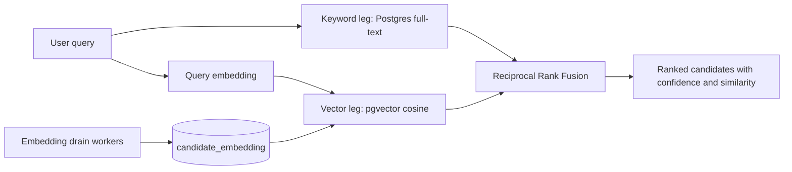
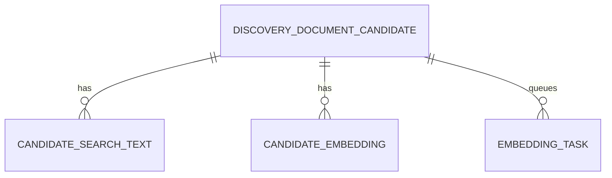
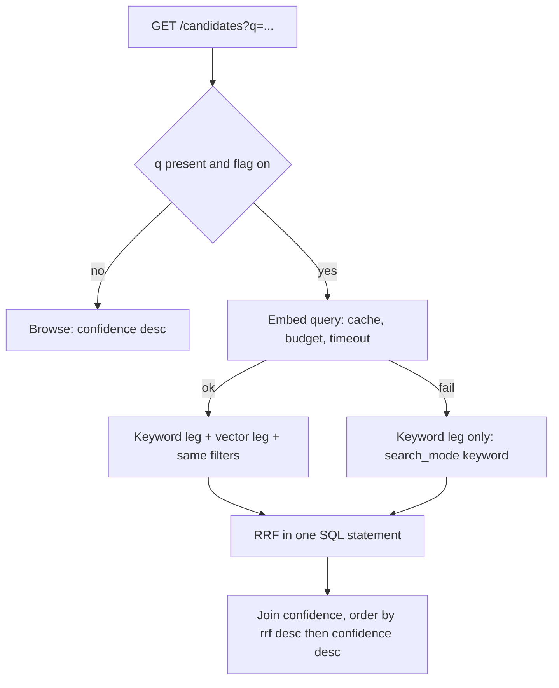

# Search-first — Architecture

**Repo:** `redtape` (`apps/api`, `apps/discovery-ingest`, `apps/web`)
**Rollout:** [01-rollout.md](01-rollout.md) · **Decisions:** [gaps-and-decisions.md](gaps-and-decisions.md) · **Chapters:** [chapters/](chapters/)
**Precedent:** [category-taxonomy-migration](../category-taxonomy-migration/00-architecture.md) (search became primary, embeddings explicitly deferred) · [document-browse-confidence](../document-browse-confidence/00-architecture.md) · [crawlers](../crawlers/00-architecture.md) (task, lease and neuron-budget patterns)

## 1. Problem

`/documents` is a category browse page with a small search box. Its `q` parameter is a case-insensitive title `ILIKE` over `title_i18n` with no index (`apps/api/app/features/discovery/repository/candidate_filter.py`, `title_matches`). It cannot match a description, a synonym, another language, or a paraphrase ("child benefit" for *Kindergeld*). Sorting is a user-visible control (confidence or title or newest, with a direction button) that has little meaning once a query ranks the results.

This suite moves the product to a search-first interface:

It also makes the interface available in seven languages (**de** source, **en**, **tr**, **ru**, **uk**, **pl**, **ro**) because search users are not only German readers.

## 2. Vocabulary

| Term | Meaning |
| --- | --- |
| **Candidate** | A row in `discovery_document_candidate`: the pool the public `/documents` list reads through `GET /api/v1/candidates`. The dormant `document` table is not searched. |
| **Search subject** | The thing a search result identifies and dedupes on. Today the candidate id; later a canonical entity id (entity resolution, out of scope). |
| **Search text** | The derived, per-locale text of a candidate that both full-text search and embeddings read (`candidate_search_text`). |
| **Canonical text** | The `de` search text: title plus the best mention excerpts. The only text embedded for now. |
| **Content hash** | SHA-256 of the canonical text plus a recipe version. Decides whether an embedding is current. |
| **Embedding task** | A leased unit of work asking a worker to embed one candidate's canonical text at one hash. |
| **Keyword leg / vector leg** | The two retrievers. Each returns a ranked list of candidate ids. |
| **RRF** | Reciprocal Rank Fusion: `score(c) = Σ 1 / (k + rank_leg(c))` over the legs that returned `c`. `k` defaults to 60. |
| **Similarity** | The vector leg's cosine similarity, rescaled to 0..1 relative to the cut-off for display. Not the same scale as confidence. |
| **Confidence** | The existing evidence score of a candidate card (max category score, `CardRelations.confidence`). Unchanged by this suite. |
| **Search mode** | `browse` (no `q`), `hybrid` (both legs), or `keyword` (keyword leg only: flag off or embedder unavailable). |

## 3. What is searched

- The corpus is the candidate pool (about 4000 rows, short texts). `document` and `GET /api/v1/documents` are dormant and out of scope; `catalogue_service` rows are inputs to candidates, not results.
- Candidate text is German: `title_i18n` is `{"de": …}` and the card description is the best mention's `excerpt` (plain `Text`). English exists only for taxonomy and jurisdictions. **Translating the documents is a separate work package** (see §11); search for non-German users therefore leans on the multilingual vector leg (decision D6).
- No aliases, alternative names or keywords exist yet. The search-text builder is the single place where they will be added.

## 4. Target data model

### `candidate_search_text`

`(candidate_id FK, locale, text, tsv_german, tsv_simple, content_hash, updated_at)`, primary key `(candidate_id, locale)`.

- Only the `de` row is written now. `locale` is in the key so translated text can be added later without a schema change.
- `tsv_german` is `to_tsvector('german', unaccent(text))`; `tsv_simple` is `to_tsvector('simple', unaccent(text))` for exact terminology and identifiers. Both are populated by the builder in SQL (not generated columns: `unaccent` is not immutable). GIN indexes on both.

### `candidate_embedding`

`(candidate_id FK, model, locale, dim, text_hash, embedding vector(N), created_at)`, primary key `(candidate_id, model, locale)`.

- `N` is fixed by the chapter 1 probe (expected 1024 for `@cf/qwen/qwen3-embedding-0.6b`; unconfirmed until probed).
- `locale` is a canonical marker for now; per-locale vectors can be added later if the evaluation (chapter 12) shows weak cross-lingual recall.
- HNSW index with `vector_cosine_ops` (initial `m=16`, `ef_construction=64`, tuned in chapter 12).
- `model` and `dim` live on every row so a model swap is a backfill, not a migration.

### `embedding_task`

`(id, candidate_id FK, model, text_hash, status, priority, attempt_count, not_before, claimed_at, lease_expires_at, claimed_by_api_key_id, last_error, created_at, updated_at)`.

- Partial unique index on `(candidate_id, model)` where `status in ('pending','claimed')`: at most one open task per candidate and model; enqueue is idempotent.
- It is a dedicated table, not a new `discovery_task` kind: `discovery_task` requires `catalogue_service_id` and `target_url` (both NOT NULL) and its claim takes no row lock.

## 5. Embedding pipeline

1. A candidate or mention is written (`features/discovery`). The builder recomputes the canonical text and hash in the same transaction and upserts `candidate_search_text`.
2. If the hash differs from the stored embedding's `text_hash` (or none exists), an `embedding_task` is enqueued or its target hash is updated.
3. The embed drain (Python CLI on GitHub Actions, `apps/discovery-ingest`) claims tasks through the machine API with `FOR UPDATE SKIP LOCKED` and a lease, reserves neurons against the shared ledger, calls Workers AI in batches, and posts vectors back. Workers never hold `DATABASE_URL`.
4. The API stores a vector only if the task's `text_hash` still equals the candidate's current hash; otherwise it discards the vector and re-enqueues (`stale`).
5. A quota or budget stop releases the batch without consuming attempts (`hand_back`), exactly as the existing drains do.

Qwen3-Embedding is instruction-aware: **queries** are embedded with an instruction prefix (`Instruct: <task>\nQuery: <q>`); **documents** are embedded raw.

## 6. Query path

- **Keyword leg.** `websearch_to_tsquery` with the `german` and `simple` configurations over the `de` row regardless of the request locale (the text is German), ranked by `ts_rank_cd`, plus the existing `title_matches` as an extra signal. The query string is normalised locale-aware before use (Turkish dotted/dotless I).
- **Vector leg.** Cosine distance over `candidate_embedding`, top-N (default 50), minimum similarity cut-off (configurable), `SET LOCAL hnsw.iterative_scan = relaxed_order` so category filters do not starve the result, with a setting to bypass the index.
- **Fusion.** One SQL statement: both legs as ranked CTEs, `FULL OUTER JOIN` on candidate id, `score = Σ 1/(k+rank)`, deduplicated by candidate id, same category and `complete` filters on both legs. One statement keeps the read transactionally consistent and avoids a second session on sync SQLAlchemy.
- **Ordering.** With a query: RRF score descending, ties broken by confidence descending. Without a query: confidence descending, always. An explicit `sort_by` from an API client still wins; the web never sends one.
- **Pagination.** The fused list is capped at top-K (default 100); `offset`/`limit` page within it and `total` is the fused size.
- **Fallback.** Embedder timeout, error, exhausted budget, or `SEARCH_HYBRID_ENABLED=false` never fails the request: the response is keyword-only with `search_mode: "keyword"`.
- **Query embedding at request time** (decision D1) needs a Workers-AI-scoped token on the API host, a per-query neuron reservation through the existing `BudgetService`, an in-process LRU cache keyed by normalised query and model, an 800–1500 ms timeout, and a rate limit on the public route.

## 7. API contract

`GET /api/v1/candidates` keeps its path and parameters (`q`, `filter[category]`, `filter[complete]`, `offset`, `limit`, `sort_by`, `sort_order`). Additions:

- list response: `search_mode: "browse" | "hybrid" | "keyword"`;
- each card: `similarity: number | null` in 0..1 (`(cosine − cutoff) / (1 − cutoff)`, clipped; `null` in `browse` and `keyword` modes or when the candidate matched only the keyword leg);
- default ordering with no `sort_by` is confidence descending (chapter 9 pins this; the two existing code paths disagree today, see [gaps-and-decisions.md](gaps-and-decisions.md) O6).

Machine API (workers): `POST /api/v1/discovery/machine/embeddings/{claim,complete,fail,release}` and a queue summary, authenticated by the existing `X-API-Key` dependency; `complete` returns a per-item result (`stored | stale | rejected`) rather than failing the whole batch.

## 8. Frontend contract

- **Search bar.** A new `SearchHero`: horizontally centred in the panel, larger and visibly raised (new `shadow.raised` semantic token, light and dark), fully rounded, with a round submit `IconButton` carrying a right arrow. It keeps the draft-until-submit behaviour of `ListSearchBox`.
- **Sorting.** The sort select and direction button are removed. Results are always shown best-first (confidence when browsing, fused rank when searching). Stale `sort_by`/`sort_order` URL parameters are ignored.
- **Category browse** stays: chips under the search bar, `filter[category]` as today.
- **Result cards** show two rings that share one component: the existing confidence ring and a new similarity ring (`ScoreRing`, Chakra `ProgressCircle`). In `keyword` mode the similarity ring is omitted, not shown as 0; a subtle hint says semantic matching is unavailable.
- Layout and copy are checked at German and Russian text lengths and at mobile width.

## 9. Interface languages

- Locales: `de` (source), `en`, `tr`, `ru`, `uk`, `pl`, `ro`. All are left-to-right. Arabic and right-to-left layout are out of scope.
- **One list in code** (`SUPPORTED_LOCALES` in `apps/api/app/shared/locale.py`) drives the seed rows and JSONB key validation; the `supported_locale.enabled` flag decides what is served. The web has a matching `localeMeta.ts`; a test ties the two together.
- A locale is **never served until enabled**, and enabled only after a recorded native-speaker review and 100% coverage. `completeness_pct` is computed from `ui_translation`, not hardcoded.
- Fallback for existing multilingual data (taxonomy, jurisdictions): requested → `en` → `de` for non-German readers; `de` → `en` for German readers.
- The web `t()` gains plural support (`Intl.PluralRules`; keys `…_one/_few/_many/_other`), `lang` is set before first paint, formatters are central, locale bundles load lazily, and parity tests cover key sets, placeholders and plural forms across all locales. Russian, Ukrainian and Polish plurals and Slavic case make noun interpolation into sentences unsafe; copy avoids it.
- UI strings and taxonomy labels (category names and descriptions) are translated by an LLM on Workers AI with a glossary and validators, then reviewed. Documents are not translated here.

## 10. Cost and limits

- **Neurons.** `@cf/qwen/qwen3-embedding-0.6b` is about 1075 neurons per million input tokens. The initial backfill (about 4000 candidates × about 150 tokens ≈ 0.6M tokens) is roughly 650 neurons against a 9,500/day free budget; a query is a few tokens. Embedding, query and translation spend share one ledger (`discovery_budget_ledger`).
- **Database.** 1024-dimension vectors are about 4 KB per row; with the HNSW index the feature adds an estimated 30–40 MB at 4000 candidates, against the 500 MB Supabase free-tier cap and the `DB_SOFT_LIMIT_BYTES` guard (writes answer 507). `halfvec` is available if this ever matters. Chapter 3 records the real size.
- **GitHub Actions minutes.** The embed drain exits early when the queue summary reports no ready work.

## 11. Seams kept for later work

- **Entity resolution.** Results dedupe on a subject id (the candidate id today). `candidate_embedding` is keyed by `(candidate_id, model, locale)`; nearest-neighbour search over the same vectors is how candidate-to-candidate resolution would start. The search-text builder is where canonical names and aliases would be added.
- **Document translation.** `candidate_search_text` is keyed by locale, `pick_i18n` is the single localisation path, and the fallback chain is already per-locale. A translation pipeline, provenance and "machine translated" labelling are a separate suite.
- **Right-to-left languages.** `localeMeta.ts` is the one place a text-direction field would go.

## 12. Non-goals

Translating documents; Arabic and right-to-left layout; entity resolution; searching the dormant `document` table or `catalogue_service`; per-language embeddings (unless chapter 12 finds they are needed); a separate search service; replacing Postgres.
