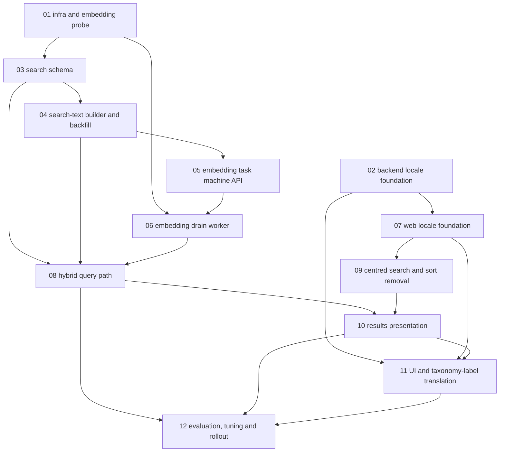

# Search-first — Rollout

**Architecture:** [00-architecture.md](00-architecture.md) · **Decisions:** [gaps-and-decisions.md](gaps-and-decisions.md) · **Chapters:** [chapters/](chapters/)

**Loop branch:** `feat/plans-search-first`
**Release branch:** `main`

## Invariants

1. Document embeddings are produced only by background drain workers on free neurons, never in a request path.
2. A failing, slow or over-budget query embedder never fails a search: the response degrades to keyword-only with `search_mode: "keyword"`.
3. Without `q`, results are ordered by confidence descending, always. With `q`, by fused rank with confidence as the tie-break.
4. Results are deduplicated by one subject id (the candidate id today) so entity resolution can replace it later.
5. An embedding is stored only if its `text_hash` still matches the candidate's current canonical text; stale results are discarded and re-queued.
6. Workers never hold `DATABASE_URL`; they use the machine API. The only Cloudflare credential on the API host is a Workers-AI-scoped token for query embedding (decision D1).
7. Neuron spend (embedding drain, query embedding, translation) is metered against the one shared ledger; a quota stop releases tasks without consuming attempts.
8. A locale is not served until it is enabled, and is enabled only after a recorded native-speaker review and 100% key coverage.
9. No chapter translates documents, adds right-to-left support, or implements entity resolution.
10. The sort controls are removed from the UI only after the API default ordering is pinned to confidence descending.
11. Every implementation chapter uses red → green → refactor, runs its named narrow checks, then the root `./ci.sh`.

## Dependency graph

## Scheduling matrix

| ID | Chapter | Depends on | Touches | Execution | Gate | Status |
| --- | --- | --- | --- | --- | --- | --- |
| C1 | Infra and embedding probe | — | docker-compose, API CI workflow, API settings and test setup, ingest embedding client and probe | chapter-implementer | Probe report + `./ci.sh` | planned |
| C2 | Backend locale foundation | — | API locale constants, resolution, seed, schemas | chapter-implementer | API tests + `./ci.sh` | planned |
| C3 | Search schema | C1 | API models, migration | chapter-implementer | Migration round-trip + `./ci.sh` | planned |
| C4 | Search-text builder, hooks and backfill | C3 | API `features/search`, discovery write paths, scripts | chapter-implementer | API tests + `./ci.sh` | planned |
| C5 | Embedding task machine API | C4 | API `features/search` machine routes, contract fixture | chapter-implementer | API + contract tests + `./ci.sh` | planned |
| C6 | Embedding drain worker | C1, C5 | discovery-ingest worker, client, CLI, GHA workflow, ops docs | chapter-implementer | Ingest tests + `./ci.sh` | planned |
| C7 | Web locale foundation | C2 | web i18n, contexts, formatters, fonts, tests | chapter-implementer | Vitest + typecheck/build + `./ci.sh` | planned |
| C8 | Hybrid query path | C3, C4, C6 | API `features/search`, `features/candidates`, schema, OpenAPI snapshot, web contract fixture | chapter-implementer | API tests + `./ci.sh` | planned |
| C9 | Centred search and sort removal | C7 | web documents feature, theme token, i18n keys, API default ordering | chapter-implementer | Vitest + typecheck/build + `./ci.sh` | planned |
| C10 | Results presentation | C8, C9 | web documents, shared `ScoreRing`, candidate types and mapper, i18n keys | chapter-implementer | Vitest + typecheck/build + `./ci.sh` | planned |
| C11 | UI and taxonomy-label translation | C2, C7, C10 | discovery-ingest `i18n` command, API seed data, web fallback bundles | chapter-implementer | Validator tests + parity tests + `./ci.sh` | planned |
| C12 | Evaluation, tuning and rollout | C8, C10, C11 | eval fixtures and script, settings defaults, ops docs, STATUS | chief-of-staff | Eval report + read-only live validation | planned |

## Parallel batches

| Batch | Chapters | Why this is safe |
| --- | --- | --- |
| B1 | C1, C2 | C1 owns infra, settings and the ingest embedding client; C2 owns locale code and seeds. No shared files (C1 edits `config.py`; C2 does not). |
| B2 | C3, C7 | C3 is API models and a migration; C7 is web i18n and fonts. Disjoint apps. |
| B3 | C4, C9 | C4 is API `features/search` and discovery write hooks; C9 is the web documents feature. C9 depends on C7 because both edit the web i18n bundles and `fallback/index.ts`. |
| B4 | C5 | Machine routes build on the builder's enqueue contract from C4. |
| B5 | C6 | Needs the claim/complete contract from C5. |
| B6 | C8 | Needs vectors from C6 to validate against and the schema/builder from C3/C4. |
| B7 | C10 | Needs the API fields from C8 and the cleared documents UI from C9. |
| B8 | C11 | Translates final copy; runs after C10 so no UI key changes afterwards. |
| B9 | C12 | Evaluation and rollout need everything. |

If two chapters in a batch must touch a shared file (`config.py`, an i18n bundle, `openapi.schemas.json`), the loop branch merges them sequentially in dependency order.

## Integration order and critical path

`C1 → C2 → C3 → C7 → C4 → C9 → C5 → C6 → C8 → C10 → C11 → C12`

The critical path for the search capability is `C1 → C3 → C4 → C5 → C6 → C8 → C10 → C12`. The i18n track (`C2 → C7`) and the UI shell (`C9`) run beside it. C11 is last before C12 because any copy added by C9 and C10 must exist before strings are translated.

## Per-chapter gates

Each chapter must:

1. list its exact files and no unrelated cleanup;
2. write one happy-path and one negative-path test before implementation and confirm both fail for the intended reason;
3. implement the smallest green change;
4. audit the containing method, class and module against the house rules (about 5 lines per function, about 100 lines per file, at most 3 parameters, no boolean flags, no `Any`, docstrings in the API and ingest apps; about 3 props per component in the web app);
5. rerun the narrow suite after each refactor extraction;
6. run its app checks and the root `./ci.sh` before its PR is merged;
7. record evidence (counts, sizes, probe output, eval numbers) in [run-ledger.md](run-ledger.md).

## Operator actions (not code)

| Action | Needed by | Where recorded |
| --- | --- | --- |
| Confirm `vector` is available on Supabase (`select * from pg_available_extensions where name = 'vector'`) and enable it; record the pgvector version | C1 gate, before C3 deploys | run ledger |
| Create a Workers-AI-only API token, store it as a Render secret for query embedding (D1), and as the GHA secret the embed drain uses | C6 (drain) and C8 (query) | run ledger |
| Set the repo variable `DISCOVERY_EMBED_SCHEDULE=enabled` | after C6 is merged and backfill ran | run ledger |
| Native-speaker review of each new locale's UI strings and taxonomy labels, recorded in the review manifest | C11, before any locale is enabled | run ledger |
| Run the backfill, then the embed drain until the queue is empty; then set `SEARCH_HYBRID_ENABLED=true` | C12 | run ledger |

## Data checkpoints

Before C8 is enabled in an environment:

- `candidate_search_text` has a `de` row for every candidate that has a title;
- `candidate_embedding` covers at least 99% of candidates at the current hash, and the stale count is recorded;
- the HNSW index exists and `EXPLAIN` shows it used for the vector leg;
- the evaluation report (C12) shows hybrid at least matching keyword on German queries.

Before any new locale is enabled:

- the locale file has the same key set, placeholders and plural forms as `en` (parity test);
- the review manifest records `reviewed`, reviewer and date;
- `completeness_pct` computed from `ui_translation` is 100.

## Branch and release protocol

The documentation suite lands first on a docs branch (`docs/search-first-plan-suite`). Each implementation chapter branches from the loop branch `feat/plans-search-first` and opens one PR into it. Use conventional commits and never commit directly to `main`.

The release branch may merge to `main` only after C1–C11 are green and merged. C12 records the evaluation and the controlled enablement; the flag `SEARCH_HYBRID_ENABLED` stays `false` in `main` until C12's gate passes.

`./ci.sh` runs `uv run`, which may rewrite `apps/discovery-ingest/uv.lock` to the corporate PyPI mirror; revert that file before committing, as in the previous suites. C1 adds a new API dependency, so commit its `uv.lock` change from a clean resolve.

## Out of scope

This rollout does not include translating documents, Arabic or right-to-left layout, entity resolution, searching the dormant `document` table, per-language embeddings (unless C12 shows they are needed), or a separate search service.
