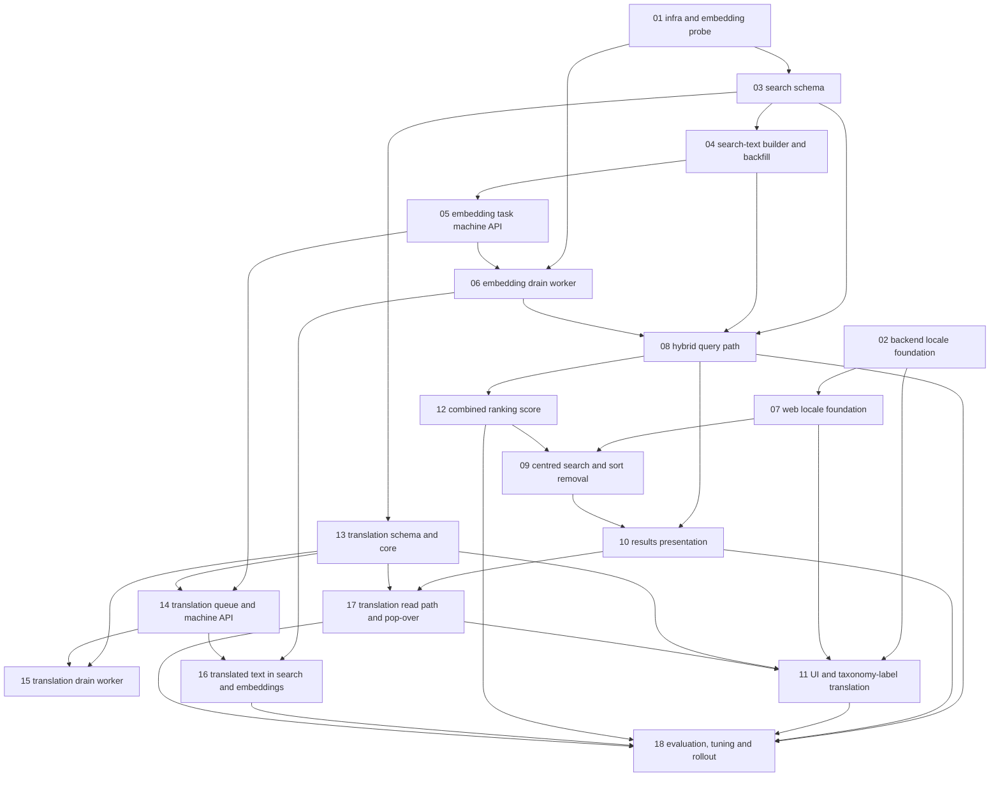

# Search-first — Rollout

**Architecture:** [00-architecture.md](00-architecture.md) · **Decisions:** [gaps-and-decisions.md](gaps-and-decisions.md) · **Chapters:** [chapters/](chapters/)

**Loop branch:** `feat/plans-search-first`
**Release branch:** `main`

## Invariants

1. Document embeddings and document translations are produced only by background workers on free neurons, never in a read path. Only the query embedding runs at request time.
2. A failing, slow or over-budget query embedder never fails a search: the response degrades to keyword-only with `search_mode: "keyword"`.
3. Ordering is the combined score (`(1 − w) · relevance + w · confidence`); without `q` it equals the confidence, so browse order is unchanged. An explicit `sort_by` from an API client wins.
4. Results are deduplicated by one subject id (the candidate id today) so entity resolution can replace it later.
5. A vector or a translation is stored only if its source hash still matches the current text; stale results are discarded and re-queued.
6. Workers never hold `DATABASE_URL`; they use the machine API. The only Cloudflare credential on the API host is a Workers-AI-scoped token for query embedding (decision D1, accepted).
7. Neuron spend (embedding drain, translation drain, query embedding, UI translation) is metered against one shared ledger; a quota stop releases tasks without consuming attempts; the translate drain never takes the ledger below the query-embedding floor.
8. A locale is not served until it is enabled, and is enabled only after a recorded native-speaker review of its interface strings and 100% key coverage.
9. Translations are stored once (text in R2, a thin index row in Postgres), labelled machine-made, shown only as a secondary pop-over beside the German original, and a human translation is never overwritten by a machine one. No live translation. Translation engines are adapters behind one port; no code outside the adapter names a provider.
10. The sort controls are removed from the UI only after the API default ordering is pinned to the combined score.
11. Database growth from this suite (search text, tsvectors, embeddings, indexes, translation index rows) stays under the existing `DB_SOFT_LIMIT_BYTES` with margin; the baseline is about 83 MB of 500 MB. It is projected in chapter 1, measured in chapters 3 and 16, and re-checked in chapter 18. Translation text is kept in R2, not the database.
12. Every implementation chapter uses red → green → refactor, runs its named narrow checks, then the root `./ci.sh`.
13. No chapter adds right-to-left support or implements entity resolution.

## Dependency graph

## Scheduling matrix

| ID | Chapter | Depends on | Touches | Execution | Gate | Status |
| --- | --- | --- | --- | --- | --- | --- |
| C1 | Infra and embedding probe | — | docker-compose, API CI workflow, API settings and test setup, ingest embedding client and probe | chapter-implementer | Probe report + `./ci.sh` | planned |
| C2 | Backend locale foundation | — | API locale constants, resolution, seed, schemas | chapter-implementer | API tests + `./ci.sh` | planned |
| C3 | Search schema | C1 | API models, migration | chapter-implementer | Migration round-trip + `./ci.sh` | planned |
| C4 | Search-text builder, hooks and backfill | C3 | API `features/search`, discovery write hooks, scripts | chapter-implementer | API tests + `./ci.sh` | planned |
| C5 | Embedding task machine API | C4 | API `features/search` machine routes and leased queue, contract fixture | chapter-implementer | API + contract tests + `./ci.sh` | planned |
| C6 | Embedding drain worker | C1, C5 | discovery-ingest worker, client, CLI, GHA workflow, ops docs | chapter-implementer | Ingest tests + `./ci.sh` | planned |
| C7 | Web locale foundation | C2 | web i18n, contexts, formatters, fonts, tests | chapter-implementer | Vitest + typecheck/build + `./ci.sh` | planned |
| C8 | Hybrid query path | C3, C4, C6 | API `features/search` query modules, `features/candidates`, schema, OpenAPI snapshot, web contract fixture | chapter-implementer | API tests + `./ci.sh` | planned |
| C9 | Centred search and sort removal | C7, C12 | web documents feature, theme token, i18n keys, API default ordering | chapter-implementer | Vitest + typecheck/build + `./ci.sh` | planned |
| C10 | Results presentation | C8, C9 | web documents, shared `ScoreRing`, candidate types and mapper, i18n keys | chapter-implementer | Vitest + typecheck/build + `./ci.sh` | planned |
| C11 | UI and taxonomy-label translation | C2, C7, C13, C17 | discovery-ingest `i18n` command, API seed data, web fallback bundles | chapter-implementer | Validator + parity tests + `./ci.sh` | planned |
| C12 | Combined ranking score | C8 | API `features/search/scoring`, `features/candidates` ordering and schema, OpenAPI snapshot, web contract fixture | chapter-implementer | API tests + `./ci.sh` | planned |
| C13 | Translation schema and core | C3 | API models, migration, settings; ingest translation core and probe | chapter-implementer | Migration round-trip + probe + `./ci.sh` | planned |
| C14 | Translation queue and machine API | C5, C13 | API `features/translation` (writes translation objects to R2), discovery write hooks, scripts, contract fixture | chapter-implementer | API + contract tests + `./ci.sh` | planned |
| C15 | Translation drain worker | C13, C14 | discovery-ingest worker, client, CLI, GHA workflow, ops docs | chapter-implementer | Ingest tests + `./ci.sh` | planned |
| C16 | Translated text in search text and embedding tasks | C6, C14 | API `features/search` builder and enqueue, settings, scripts | chapter-implementer | API tests + `./ci.sh` | planned |
| C17 | Translation read path and pop-over | C10, C13 | API `features/candidates` read path, stored-text route and schema; web documents, hooks and candidates, i18n keys | chapter-implementer | API + Vitest + typecheck/build + `./ci.sh` | planned |
| C18 | Evaluation, tuning and rollout | C8, C10, C11, C12, C16, C17 | eval fixtures and script, settings defaults, ops docs, STATUS | chief-of-staff | Eval report + read-only live validation | planned |

## Parallel batches

| Batch | Chapters | Why this is safe |
| --- | --- | --- |
| B1 | C1, C2 | C1 owns infra, settings and the ingest embedding client; C2 owns locale code and seeds. No shared files (C1 edits `config.py`; C2 does not). |
| B2 | C3, C7 | C3 is API models and a migration; C7 is web i18n and fonts. Disjoint apps. |
| B3 | C4, C13 | C4 is API `features/search` and discovery write hooks; C13 is API models plus a second migration (after C3's) and the ingest translation core. Merge C3's migration first so there is a single head. |
| B4 | C5 | Machine routes and the generic leased queue build on the builder's enqueue contract from C4; C14 reuses that queue. |
| B5 | C6, C14 | C6 is the ingest embed drain; C14 is API translation routes. Different apps. Both regenerate or extend the machine contract only in their own sections; merge sequentially. |
| B6 | C8, C15, C16 | C8 adds query modules and edits the candidates feature; C15 is ingest only; C16 edits the search builder and enqueue. C8 and C16 share `features/search` and `config.py`: merge in dependency order (C16 after C8 if they conflict). |
| B7 | C12 | The scoring module and ordering sit on C8's fused relation. |
| B8 | C9 | Needs C12's default ordering and C7's locale plumbing (both edit web i18n bundles). |
| B9 | C10 | Needs the API fields from C8 and C12 and the cleared documents UI from C9. |
| B10 | C17 | Needs C10's card layout and C13's tables; API and web in one chapter because the contract is small. |
| B11 | C11 | Translates final copy; runs after C17 so no UI key changes afterwards; uses the C13 translation core. |
| B12 | C18 | Evaluation and rollout need everything. |

If two chapters in a batch must touch a shared file (`config.py`, an i18n bundle, `openapi.schemas.json`, the machine contract fixture), the loop branch merges them sequentially in dependency order.

## Integration order and critical path

`C1 → C2 → C3 → C7 → C4 → C13 → C5 → C6 → C14 → C8 → C15 → C16 → C12 → C9 → C10 → C17 → C11 → C18`

The critical path is `C1 → C3 → C4 → C5 → C6 → C8 → C12 → C9 → C10 → C17 → C11 → C18`. The translation track (`C13 → C14 → C15/C16`) runs beside the search track and feeds the evaluation. C11 is last before C18 because any copy added by C9, C10 and C17 must exist before strings are translated.

## Per-chapter gates

Each chapter must:

1. list its exact files and no unrelated cleanup;
2. write one happy-path and one negative-path test before implementation and confirm both fail for the intended reason;
3. implement the smallest green change;
4. audit the containing method, class and module against the house rules (about 5 lines per function, about 100 lines per file, at most 3 parameters, no boolean flags, no `Any`, docstrings in the API and ingest apps; about 3 props per component in the web app);
5. rerun the narrow suite after each refactor extraction;
6. run its app checks and the root `./ci.sh` before its PR is merged;
7. record evidence (counts, sizes, probe output, eval numbers) in [run-ledger.md](run-ledger.md).

## Operator actions (not code)

| Action | Needed by | Where recorded |
| --- | --- | --- |
| Confirm `vector` is available on Supabase (`select * from pg_available_extensions where name = 'vector'`) and enable it; record the pgvector version | C1 gate, before C3 deploys | run ledger |
| Create a Workers-AI-only API token; store it as a Render secret for query embedding (D1) and as the GHA secret the embed and translate drains use | C6, C15 (drains), C8 (query) | run ledger |
| Confirm the R2 bucket and credentials already used for artifacts are present on the API host (translations reuse them; no new bucket) | C14 | run ledger |
| Review the translation probe sample sheets with native speakers and confirm the engine decision | C13 gate | run ledger |
| Later, not in this suite: Azure Translator resource, key and region (O17) | when an Azure adapter is scheduled | run ledger |
| Set the repo variables `DISCOVERY_EMBED_SCHEDULE=enabled` and `DISCOVERY_TRANSLATE_SCHEDULE=enabled` | after C6 / C15 are merged and backfills ran | run ledger |
| Native-speaker review of each new locale's interface strings and taxonomy labels, recorded in the review manifest | C11, before any locale is enabled | run ledger |
| Run the backfills and drains in the order given in C18, then set `SEARCH_HYBRID_ENABLED=true` | C18 | run ledger |

## Data checkpoints

Before C8 is enabled in an environment:

- `candidate_search_text` has a `de` row for every candidate that has a title;
- `candidate_embedding` covers at least 99% of candidates at the current hash for each embedded locale, and the stale count is recorded;
- the HNSW index exists and `EXPLAIN` shows it used for the vector leg;
- the projected and measured database size is under `DB_SOFT_LIMIT_BYTES` with margin;
- the evaluation report (C18) shows hybrid at least matching keyword on German queries.

Before translations are served or searched:

- the chapter 13 probe has been reviewed and the engine decision recorded;
- translated candidates per locale and the validator failure rate are recorded;
- no `human` row was overwritten (checked by a query in the ledger);
- the number of translation index rows equals the number of stored translation objects within tolerance (orphans from replaced objects are counted and small).

Before any new locale is enabled:

- the locale file has the same key set, placeholders and plural forms as `en` (parity test);
- the review manifest records `reviewed`, reviewer and date;
- `completeness_pct` computed from `ui_translation` is 100.

## Branch and release protocol

The documentation suite lands first on a docs branch (`docs/search-first-plan-suite`). Each implementation chapter branches from the loop branch `feat/plans-search-first` and opens one PR into it. Use conventional commits and never commit directly to `main`.

The release branch may merge to `main` only after C1–C17 are green and merged. C18 records the evaluation and the controlled enablement; the flag `SEARCH_HYBRID_ENABLED` stays `false` in `main` until C18's gate passes.

`./ci.sh` runs `uv run`, which may rewrite `apps/discovery-ingest/uv.lock` to the corporate PyPI mirror; revert that file before committing, as in the previous suites. C1 adds a new API dependency, so commit its `uv.lock` change from a clean resolve.

## Out of scope

This rollout does not include Arabic or right-to-left layout, entity resolution, searching the dormant `document` table, live translation, translating every mention excerpt, or a separate search service.
