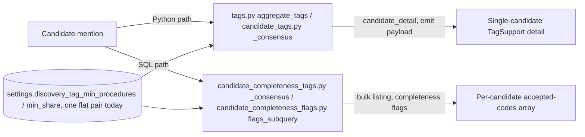

# Situation tag activation — Architecture

**Rollout:** [01-rollout.md](01-rollout.md) · **Decisions:** [gaps-and-decisions.md](gaps-and-decisions.md) · **Live runs:** [02-live-runs.md](02-live-runs.md) · **Chapters:** [chapters/](chapters/) · **Parent:** [situation-tag-coverage](../situation-tag-coverage/00-architecture.md) (spike complete, T-PENDING partially resolved by this suite)

## 1. Why

`situation-tag-coverage` was a measurement-only spike (five chapters, all merged to `main`) that proved situation-axis tagging is broken in production — 0 of 4,627 candidates get an accepted situation code — and ran the tooling needed to find out why, live, against real data. Its live numbers, recorded in that suite's `02-live-runs.md` and `gaps-and-decisions.md` T-PENDING table, are the evidence base this suite ships against:

- **LR1**: page-level extraction is not the bottleneck — `situation_tag_agreement` is 0.85, *higher* than domain's 0.65, at the page level. The model's own per-page situation-code extraction is not the weak link.
- **LR2**: 86% of all 4,627 candidates (3,979) have exactly one distinct procedure mentioning them — structurally incapable of clearing the 2-procedure consensus floor on *any* axis, independent of model accuracy. Only 14% (648) even have the structural possibility, and within that minority, situation never corroborates while domain does — an axis-specific problem on top of the shared count-floor problem, not just the count floor alone.
- **LR4**: baseline 0 of 4,627 candidates accepted; relaxing to `min_procedures=1` for situations recovers 19. The precision half — hand-labelling the newly-accepted candidates — was never run.

Put together: the fix is not "make the model better at tagging situations" (LR1 already rules that out). It is "stop applying a consensus rule tuned for domains, which recur naturally across unrelated procedures, to an axis whose defining property is one procedure per situation." That is a production behaviour change, which is exactly what the parent suite's own invariant 1 ("no chapter changes production tagging behaviour") ruled out of scope for itself — hence a new sibling suite rather than more chapters there, following house convention (`discovery-admin-ui`→`discovery-admin-remediation`, `discovery-online`→`discovery-online-smoke`).

The user's instruction: ship the actual fix — properly classify documents on all axes, with a measure of precision riding along — while deferring human verification of that precision to a social layer that does not exist yet. What's deliberately **not** in scope: any new curation/voting/editing UI or endpoint. The repo already has a complete-but-unwired social layer (`apps/api/app/features/voting/` — cast→tally→threshold→promote against a `Suggestion`, plus `tags.py`'s unwired `MANUAL_EXTRACTOR`/`curated_codes()` override seam) that a later suite will extend. This suite only ships better automatic classification with a visible confidence signal riding along for whenever that later review surface exists.

## 2. Vocabulary

Carried over from the parent suite (chip, axis, consensus, support, completeness flag — see [situation-tag-coverage/00-architecture.md §2](../situation-tag-coverage/00-architecture.md)), plus what this suite adds:

| Term | Meaning |
| --- | --- |
| **Axis-aware threshold** | A `min_procedures`/`min_share` pair that differs by axis, replacing today's one flat pair applied to both — domain keeps 2/50%, situation moves to 1/50% |
| **Confidence tier** | A computed `"high"`/`"low"` label on every accepted code: `"high"` means the code would have cleared the historical, axis-blind 2-procedure floor regardless of which axis rule is active; `"low"` means it was accepted only because the relaxed situation-axis rule let it through |
| **Consensus engine duplication** | The pre-existing fact that the same support/acceptance formula is implemented twice — once in Python (`tags.py`/`candidate_tags.py`, single-candidate detail/emit path) and once in SQL (`candidate_completeness_tags.py`/`candidate_completeness_flags.py`, bulk listing/completeness-flag path) — both reading the same flat settings today, confirmed by direct read (§3) |
| **PVOG situation signal** | A `situation_codes` assertion attached directly to a PVOG-sourced mention, derived from the Lebenslage `personalMatters` leaf code the discovery crawl already discards today, independent of (and corroborating alongside) the LLM-extracted page assertion |

## 3. The two-engine duplication, confirmed by direct read

Both engines read the same flat `settings.discovery_tag_min_procedures`/`discovery_tag_min_share`:

- **Python** (single-candidate detail/emit path): `apps/api/app/features/discovery/tags.py` (`aggregate_tags`, `TagSupport`, `curated_codes`/`MANUAL_EXTRACTOR`) → `apps/api/app/features/discovery/candidate_tags.py` (`_consensus()`, `_axis_support()` — no axis parameter, same thresholds for both axes). This path returns the *full* per-code breakdown, including codes that didn't clear the bar, because `candidate_admin_service.py::candidate_detail()` needs every code's support for the admin `TagSupportChip` display, not just the accepted ones.
- **SQL** (bulk listing/completeness-flag path): `apps/api/app/features/discovery/repository/candidate_completeness_tags.py` (`TagAxis` enum lives here today; `TagThresholds.from_settings()`, flat) → `.../candidate_completeness_flags.py::flags_subquery()` (one `TagThresholds` object reused for both `TagAxis.DOMAIN` and `TagAxis.SITUATION`). This path only returns the final *accepted*-codes array per candidate — no per-code detail survives it.

**Why this is genuinely mergeable, not just two things that happen to agree today:** both engines already build on identical raw ingredients — `_support()` (procedures per code) and `_tagged()` (total tagged procedures) in the SQL module compute exactly what `tags.py`'s pure-Python `_procedures_by_code`/`_support` re-derive from an in-memory loop. `candidate.mentions` (what the Python path iterates) is consumed in exactly one place (`candidate_emit_payload.py:20`), and `candidate_tag_suggestions()` has exactly two callers (`candidate_emit_payload.py::suggested_tags()` and `candidate_admin_service.py::candidate_detail()`) — both already have `candidate_id` and a DB session on hand, so neither is structurally tied to the ORM-loaded mention list. Chapter 1 adds one more SQL query shape (per-code support *without* the accept-filter, for one candidate) and retires the Python aggregator entirely, rather than keeping both engines hand-synced going forward — the named risk this suite exists partly to close.

Three call sites of `TagThresholds.from_settings(settings)` need updating regardless of the merge: `apps/api/app/features/candidates/repository/cards.py`, `.../discovery/repository/candidate_completeness_repository.py`, `.../discovery/repository/candidate_relations.py`.

**Confidence is computed live, never stored.** No model/migration carries it; `accepted_codes()` collapses `TagSupport` to a bare `str`, and `SuggestedTags`/`new_document_payload()` carry only bare `domain_codes`/`situation_codes` lists into `NewDocumentPayload` (`extra="forbid"` — new fields must be declared explicitly). This also confirms **no backfill chapter is needed**: a threshold change takes effect on the very next read, with zero migration — see [gaps-and-decisions.md](gaps-and-decisions.md) D1.

**PVOG wiring is confirmed end to end.** `apps/discovery-ingest/discovery_ingest/pvog/client.py::iter_records()` discards the discovering Lebenslage `code` at its `yield record`. `map_pvog_record()` stores `raw_payload=dict(row)` on the catalogue row. Separately, `worker/harvest.py::handle_harvest_payload()` later reads that same `catalogue.raw_payload` back and calls `harvest_pvog_payload(catalogue.raw_payload)` to build `MentionDraft`s, which `_items()` turns into `MentionItem`s via `MentionItem(catalogue_service_id=..., **draft.model_dump())` — any field added to `MentionDraft` flows through automatically. Today `domain_codes`/`situation_codes` live only on `MentionItem`, not the base `MentionDraft` — moving them up is the one structural change chapter 3 needs. Extractor values are unconstrained strings, so no enum/migration is needed for a new PVOG-sourced value; nothing but `MANUAL_EXTRACTOR` is special-cased in either consensus engine.

## 4. The options catalogue

The parent suite's own options catalogue (`situation-tag-coverage/00-architecture.md §4`) already closed every live alternative except three, which this suite ships:

| # | Option | One line | Parent reference |
| --- | --- | --- | --- |
| A1 | Axis-aware consensus thresholds | Trust a single confidently-grounded page assertion for situation codes (`min_procedures=1`) instead of requiring 2-procedure corroboration; domain's threshold is untouched | Parent's S4 |
| A2 | PVOG `personalMatters` signal | Thread the Lebenslage code already live in `client.py`'s walk through to each mention, mapped to the 12 of 18 situation codes with an unambiguous leaf | Parent's S3 |
| A3 | Tag confidence tier | New in this suite, not in the parent's catalogue — a computed `"high"`/`"low"` label riding along on every accepted code, so a future review surface can see which codes only cleared the relaxed bar | — |

A3 exists because A1 alone, shipped without any accompanying signal, would make every accepted situation code look equally trustworthy to a future reviewer even though some only cleared a deliberately relaxed bar. It costs nothing in behaviour — it does not gate anything — and rides on data (`TagSupport.procedures`/`.share`) the merged engine already computes.

## 5. Why not the alternatives

Per the parent suite's own closed options (`situation-tag-coverage/00-architecture.md §5`, `gaps-and-decisions.md` T1–T3): a free static mapping from the stored PVOG/GovData payload is closed (no Lebenslage/category keys survive in `raw_payload` for the GovData side; PVOG's own `code` is the thing chapter 3 threads through instead), taxonomy growth is out of scope, and per-document direct classification (S5) is confirmed to underperform the page-level baseline (`situation_tag_agreement` 0.40 vs 0.75, LR5) and is not revisited here. No new alternative has emerged since; this suite's job is to ship the three options the parent suite's live runs already pointed at, not to re-open the catalogue.

## 6. Recommendation

Ship A1 (chapter 1), A3 (chapter 2) and A2 (chapter 3) together, in that dependency order, on one loop branch, then run one post-deploy live step (`02-live-runs.md`) that finally completes the parent suite's unrun LR4 precision half — against the real shipped change, split by which mechanism (relaxed threshold vs. PVOG corroboration) newly qualified each candidate, so either knob can be independently rolled back from its own sample if it looks bad. The existing curator-override mechanism (`tags.py`'s `curated_codes()`) remains the backstop for any wrong code a human catches, exactly as it is today — nothing about this suite changes how an override works, only how the unreviewed automatic signal is computed and labelled.

## Out of scope

Any new curation/voting/editing UI or endpoint (the social layer in `apps/api/app/features/voting/` is complete but unwired; a later suite extends it); domain's threshold (no data supports changing it); fixing the PVOG `seen_lb_ids` first-hit-only dedupe (open seam, not a blocker — carried from the parent suite); storing the confidence tier on the live `document` row post-promotion; a general-purpose document-text extraction pipeline or any revisit of per-document classification (S5, ruled out by LR5).
