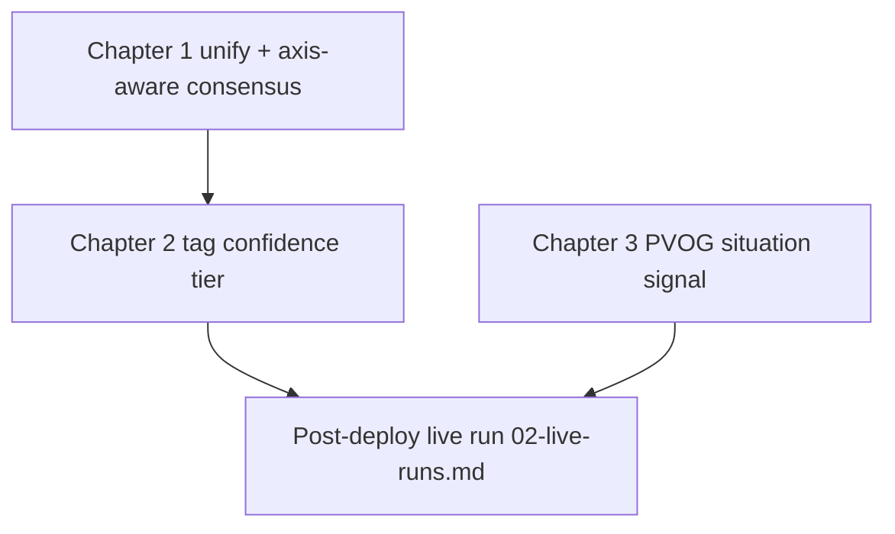

# Situation tag activation — Rollout

**Architecture:** [00-architecture.md](00-architecture.md) · **Decisions:** [gaps-and-decisions.md](gaps-and-decisions.md) · **Live runs:** [02-live-runs.md](02-live-runs.md) · **Chapters:** [chapters/](chapters/) · **Parent suite:** [situation-tag-coverage](../situation-tag-coverage/01-rollout.md)

**Loop branch:** `feat/plans-situation-tag-activation`
**Release branch:** `main`

## The invariants

1. **This suite changes production tagging behaviour — unlike its parent.** `situation-tag-coverage` was spike-only by its own invariant 1; this suite exists specifically to ship the fix that spike measured.
2. **Both consensus engines move together in one chapter, never split across a deploy.** Chapter 1 merges the Python and SQL engines *and* adds the axis-aware threshold in the same chapter/deploy. An intermediate state where only one has landed is exactly the kind of transient divergence this suite exists to eliminate forever, not just reduce — within chapter 1 itself, the merge still lands as its own commit, proven behaviour-preserving, before the threshold change lands as a second commit on top.
3. **Nothing here builds new human-review UI.** The confidence tier (chapter 2) and the PVOG signal (chapter 3) both produce data for a review surface; reuse the existing voting/manual-override scaffolding (`apps/api/app/features/voting/`, `tags.py`'s `curated_codes()`) later rather than building anything new now.
4. **Every chapter ships with tests before it's done.** Red/green/refactor, per chapter.
5. **No code change ships without `./ci.sh` green in its app.** `apps/api` or `apps/discovery-ingest`, whichever the chapter touches.
6. **The post-deploy live run happens only after all three chapters are built, merged and deployed.** `02-live-runs.md` is not executed chapter by chapter; it runs once, at the end, against the real shipped change — and only once chapter 3's own blocking prerequisite (a human spot-check of the PVOG mapping) is recorded.

## Dependency graph



Chapter 1 must land first: chapter 2's `accepted_supports()`/`confidence_tier()` build on `candidate_tag_suggestions()`'s post-merge `(session, candidate_id)` signature, and chapter 2's `SuggestedTags.tag_confidence` is computed over the same `TagSupport` values chapter 1's merged engine produces. Chapter 3 lives entirely in `apps/discovery-ingest` and has no code dependency on chapters 1 or 2 — it can run in parallel with them — but it has its own blocking prerequisite below.

## Execution order (chief of staff)

1. Chapter 1, alone first (`apps/api`) — the engine merge, proven behaviour-preserving, then the axis-aware threshold on top, as two commits within the one chapter.
2. Chapter 2, after chapter 1 is merged (`apps/api`).
3. Chapter 3 (`apps/discovery-ingest`) may run at any point, in parallel with 1/2 — but **its implementation may not start until its Step 0 blocking prerequisite is recorded**: a human spot-check of `.plans/situation-tag-coverage/lr3-personal-matters-mapping.md`'s 14 ambiguous rows and 18 clean rows, signed off (or corrected) in `situation-tag-coverage/gaps-and-decisions.md`. Until that sign-off exists, chapter 3 stays blocked regardless of chapters 1/2's progress.

## Chapters

| # | Chapter | App | Gate | Plan | Status |
| --- | --- | --- | --- | --- | --- |
| 1 | Unify the consensus engine, then make it axis-aware | api | pytest + ./ci.sh | [chapters/01-axis-aware-consensus-thresholds.md](chapters/01-axis-aware-consensus-thresholds.md) | planned |
| 2 | Tag confidence tier on the suggestion payload | api | pytest + ./ci.sh | [chapters/02-tag-confidence-tier.md](chapters/02-tag-confidence-tier.md) | planned |
| 3 | PVOG `personalMatters` as an independent situation signal | discovery-ingest | pytest + ./ci.sh | [chapters/03-pvog-situation-signal.md](chapters/03-pvog-situation-signal.md) | planned — Step 0 sign-off recorded (T4), unblocked |

## Per-chapter gate

```bash
cd apps/api && ./ci.sh                   # chapters 1, 2
cd apps/discovery-ingest && ./ci.sh      # chapter 3
```

## Branch and release protocol

Each chapter uses a feature branch off `feat/plans-situation-tag-activation` (naming convention `feat/situation-tag-activation-<chapter-slug>`) and opens one PR into that loop branch. After all three chapters are merged and deployed, and the post-deploy live run is recorded in `gaps-and-decisions.md`, one release PR from `feat/plans-situation-tag-activation` to `main`.
