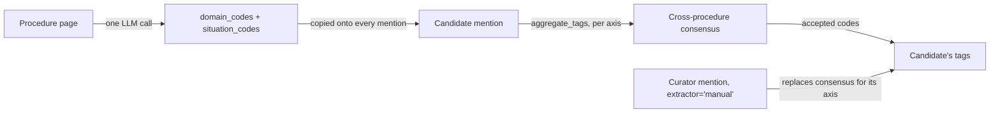

# Situation tag coverage — Architecture

**Rollout:** [01-rollout.md](01-rollout.md) · **Decisions:** [gaps-and-decisions.md](gaps-and-decisions.md) · **Live runs:** [02-live-runs.md](02-live-runs.md) · **Chapters:** [chapters/](chapters/) · **Parent:** [extraction](../extraction/00-architecture.md)

## 1. Why

Documents carry two independent taxonomy chips: 13 domain codes and 18 life-situation codes (`apps/api/scripts/seed_data/taxonomy.py`, served read-only via `GET /machine/taxonomy`). Both axes are assigned the same way, by the same mechanism, yet in production one axis is tagged and the other is not.

The 2026-10-29 production drain tagged domain codes on 6 of 58 candidates and situation codes on **none** (`.plans/extraction/run-ledger.md`, ~line 65): "Tags: domain codes on 6 of 58 candidates... situation codes on none. With a single procedure per document the support rule (at least 2 procedures and 50 percent) leaves almost everything untagged."

**Root cause.** Domains are broad subject areas ("work-employment", "housing") that recur naturally across many unrelated procedures, so a document tagged with one easily clears the 2-procedure consensus bar (§3). A life situation ("birth-of-child") is, by definition, the one triggering event that one specific procedure exists to handle. A document tied to that situation essentially never gets a second, independent procedure asserting the same situation, because there usually isn't a second procedure. This is **structural**, not primarily an LLM accuracy problem: the aggregation rule in `apps/api/app/features/discovery/tags.py` is axis-blind, and an axis-blind rule tuned for domains starves the situation axis by construction.

## 2. Vocabulary

| Term | Meaning |
| --- | --- |
| **Chip** | One taxonomy code shown on a document's front page; a document can carry several per axis |
| **Axis** | Domain or life situation — the two independent code sets a page is classified against |
| **Consensus** | The cross-procedure agreement rule in `tags.py`'s `aggregate_tags`: a code is accepted only if it appears on at least `min_procedures` distinct procedures (default 2) and on at least `min_share` of the candidate's tagged procedures (default 0.5) |
| **Support** | `TagSupport` — one code's measured procedure count, share and accepted flag, computed per axis by `candidate_tags.py`'s `_axis_support` |
| **Completeness flag** | A per-candidate boolean recorded by `apps/api/app/features/discovery/repository/candidate_completeness_flags.py` (`FLAG_NAMES`, including `has_situation`); used to prioritise review queues, not to gate aggregation |

## 3. How tagging works today

Both axes are assigned by one LLM call per crawled **procedure page**, not per document: `apps/discovery-ingest/discovery_ingest/extract/llm/{schema.py,prompt.py,prompt_template.py}`, `PROMPT_VERSION="ext-5"`. `PageExtraction` (`schema.py`) allows up to 2 `domain_codes` (`Field(max_length=MAX_DOMAIN_CODES)`, required) and up to 3 `situation_codes` (`Field(default_factory=list, max_length=MAX_SITUATION_CODES)`, optional since extraction decision D4). The handler copies the page's codes onto every mention it posts for that page.

A candidate document's final tags are a cross-procedure **consensus**, not a copy of any one page's call. `tags.py`'s `aggregate_tags(mentions, min_procedures=DEFAULT_MIN_PROCEDURES=2, min_share=DEFAULT_MIN_SHARE=0.5)` accepts a code only if `TagSupport.accepted`: at least 2 distinct procedures carry it, and it is on at least 50 percent of the candidate's tagged procedures. `candidate_tags.py`'s `candidate_tag_suggestions()` calls `_axis_support()` once for domains and once for situations, with the identical rule — **the rule is axis-blind**. This whole mechanism is decision X8 in `.plans/extraction/gaps-and-decisions.md` ("The model tags the procedure page; documents get the consensus").

A human-curator override already exists and is already built: `tags.py`'s `curated_codes()` — any single mention with `extractor == "manual"` fully replaces the consensus for that axis (`share=1.0`, `accepted=True` unconditionally). Nothing new is needed to let a reviewer hand-fix a candidate's situation codes today; the gap is that nothing currently surfaces *which* candidates need it at scale.

## 4. The options catalogue

| # | Option | One line |
| --- | --- | --- |
| S1 | Split the eval metric by axis | `discovery_ingest`'s eval harness pools domain+situation Jaccard into one number; split it so situation accuracy is visible instead of masked by domain accuracy |
| S2 | Measure the consensus ceiling | Report, against production `discovery_candidate_mention` data, what share of candidates could ever clear a 2-procedure bar on any axis — quantifies the structural ceiling before touching the rule |
| S3 | PVOG `personalMatters` capture | Thread the Lebenslage `code` already live in `client.py`'s `iter_records()` walk through to each row instead of discarding it, then hand-map the vocabulary to the 18 situation codes |
| S4 | Axis-aware consensus thresholds | Make situation-axis acceptance trust a single confidently-grounded page assertion (e.g. `min_procedures=1` for that axis only) instead of requiring 2-procedure corroboration |
| S5 | Per-document direct classification | Classify documents by situation directly from document text/name instead of inheriting the page's tags, and measure whether that signal exists at all |

## 5. Why not the alternatives

| Alternative | Verdict |
| --- | --- |
| A free static mapping from the stored PVOG/GovData payload | **Closed.** Crawlers census F4 ran against the production catalogue (520 PVOG rows, 893 GovData rows) and found the stored `raw_payload` carries no Lebenslage/category keys — only bare LeiKa identifiers (`leikakeys` for PVOG; `leika_bezeichnung`/`leika_name`/`leika_key` for GovData). `.plans/crawlers/run-ledger.md` line 43; recorded as an open seam in `.plans/extraction/gaps-and-decisions.md` |
| Growing the taxonomy itself | **Out of scope.** The 18 situation codes aren't missing — assigning codes that already exist to documents is the problem, not the vocabulary's size. No pipeline exists anywhere in this repo to discover new taxonomy codes from documents, and none is being built here |
| A "graph/traversal" reframe (life situation as a procedure attribute, not a document attribute) | **Not a sixth option.** If S4 ships, that is functionally what you get — trusting the single procedure's assertion — without any schema change. Listing it separately would double-count S4 |

## 6. Recommendation

The working hypothesis is to ship **S4** (axis-aware consensus — trust a single confidently-grounded page assertion for situation codes) **plus S3** (the PVOG `personalMatters` capture) wherever S3's hand-mapping spike comes back clean, backstopped by the existing curator-override mechanism (`tags.py`'s `curated_codes`) prioritised via the `has_situation` completeness flag. S5 is predicted to underperform — most documents are generic bureaucratic forms ("Antrag auf …") with no situation signal in isolation, the signal lives in the surrounding procedure narrative — but it is cheap enough against the 47 gold documents to confirm rather than assume. See `gaps-and-decisions.md`'s pending decision (T-PENDING) for the forcing numbers this bet still needs.

## Out of scope

Full production rollout of S3, S4 or S5 beyond building and running the measurement tools; translation; growing the taxonomy itself.
