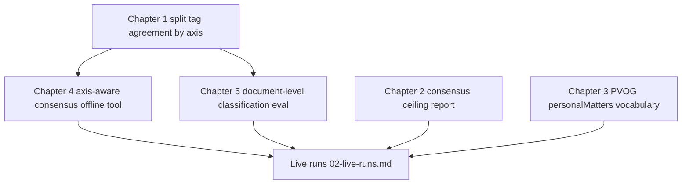

# Situation tag coverage — Rollout

**Architecture:** [00-architecture.md](00-architecture.md) · **Decisions:** [gaps-and-decisions.md](gaps-and-decisions.md) · **Live runs:** [02-live-runs.md](02-live-runs.md) · **Chapters:** [chapters/](chapters/) · **Parent suite:** [extraction](../extraction/01-rollout.md)

**Loop branch:** `feat/plans-situation-tag-coverage`
**Release branch:** `main`

## The four invariants

1. **This is a spike suite.** No chapter changes production tagging behaviour by itself; chapters add tested measurement tools that the live runs then point at real data. Nothing here flips a default on its own.
2. **Every chapter ships with tests before it's done.** Red/green/refactor: a failing test first, the smallest change to pass it, then the refactor audit, for every chapter.
3. **No code change ships without `./ci.sh` green in its app.** `apps/discovery-ingest` or `apps/api`, whichever the chapter touches.
4. **The live runs happen only after all five chapters are built.** `02-live-runs.md` is not executed chapter by chapter; it runs once, at the end, against the finished tools.

## Dependency graph



Chapters 1, 2 and 3 have no dependency on each other or on anything else in this suite; chapters 4 and 5 both need the split metric chapter 1 produces.

## Execution order (chief of staff)

1. Chapters 1, 2 and 3, in any order — they may run in parallel, each on its own branch.
2. Chapter 4, after chapter 1 is merged.
3. Chapter 5, after chapter 1 is merged (independently of chapter 4; chapters 4 and 5 may also run in parallel once chapter 1 is in).

## Chapters

| # | Chapter | App | Gate | Plan | Status |
| --- | --- | --- | --- | --- | --- |
| 1 | Split tag agreement by axis | discovery-ingest | pytest + ./ci.sh | [chapters/01-split-tag-agreement-by-axis.md](chapters/01-split-tag-agreement-by-axis.md) | planned |
| 2 | Consensus ceiling report | api | pytest + ./ci.sh | [chapters/02-consensus-ceiling-report.md](chapters/02-consensus-ceiling-report.md) | planned |
| 3 | PVOG personalMatters vocabulary | discovery-ingest | pytest + ./ci.sh | [chapters/03-pvog-personal-matter-vocabulary.md](chapters/03-pvog-personal-matter-vocabulary.md) | planned |
| 4 | Axis-aware consensus offline tool | api | pytest + ./ci.sh | [chapters/04-axis-aware-consensus-offline-tool.md](chapters/04-axis-aware-consensus-offline-tool.md) | planned |
| 5 | Document-level classification eval | discovery-ingest | pytest + ./ci.sh | [chapters/05-document-level-classification-eval.md](chapters/05-document-level-classification-eval.md) | planned |

## Per-chapter gate

```bash
cd apps/discovery-ingest && ./ci.sh      # chapters 1, 3, 5
cd apps/api && ./ci.sh                   # chapters 2, 4
```

## Branch and release protocol

Each chapter uses a feature branch off `feat/plans-situation-tag-coverage` and opens one PR into that loop branch. After all five chapters are merged and the live runs are recorded in `gaps-and-decisions.md`, one release PR from `feat/plans-situation-tag-coverage` to `main`.
