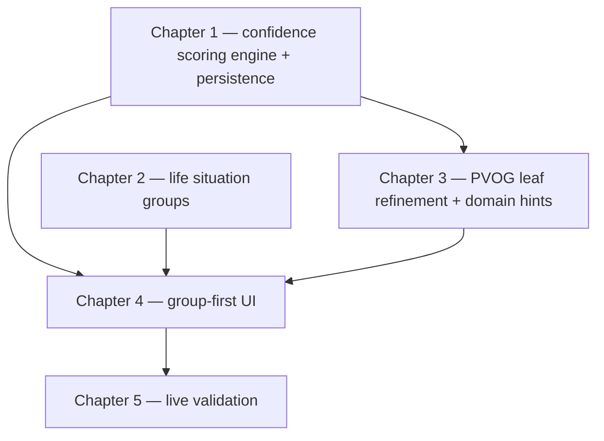

# Situation tag hierarchy — Rollout

**Architecture:** [00-architecture.md](00-architecture.md) · **Decisions:** [gaps-and-decisions.md](gaps-and-decisions.md) · **Chapters:** [chapters/](chapters/) · **Prior suite:** [situation-tag-activation](../situation-tag-activation/01-rollout.md)

**Loop branch:** `feat/plans-situation-tag-hierarchy`
**Release branch:** `main`

## The invariants

1. **No accept/reject boolean survives anywhere in the tagging pipeline.** Every place that reads `TagSupport.accepted` or `confidence_tier()` today reads a continuous score instead, by the end of chapter 1. The only cutoff left is the non-statistical inclusion floor (`MIN_SUGGESTED_SCORE`).
2. **The threshold rollback stays closed.** `discovery_tag_min_procedures_situation` is not touched; it becomes irrelevant once chapter 1 removes the binary gate it fed.
3. **Grouping is presentation-only.** Chapter 2 never changes a situation code's meaning, its mentions, or any consensus computation — only adds a parent layer above the existing 18.
4. **PVOG leaf refinement is deterministic-only.** Chapter 3 never routes a leaf code through the LLM or through consensus; it is either present on a PVOG-sourced mention/document or absent.
5. **No new curation/voting UI.** The scoring design in chapter 1 leaves room for a vote-count term, but no queue or review workflow is built in this suite.
6. **Every chapter ships with tests before it's done; red/green/refactor, per chapter.**
7. **No code change ships without `./ci.sh` green in its app** — `apps/api`, `apps/discovery-ingest`, or `apps/web`, whichever the chapter touches.
8. **The post-deploy live run happens only after all four build chapters are merged and deployed**, against the real shipped change, the same way `situation-tag-activation`'s own live run did.

## Dependency graph



Chapter 3 depends on chapter 1, not parallel with it as the originating design session first assumed: both touch `document_life_situation` (chapter 1 adds `confidence`, chapter 3 adds `pvog_leaf_code` in a follow-up migration), and chapter 3 populates the `direct_situation_confidence`/`direct_domain_confidence` mention columns chapter 1 defines — see `gaps-and-decisions.md` D10. Chapter 4 depends on all three earlier chapters: it renders the persisted confidence chapter 1 adds, the group tier chapter 2 adds, and the leaf-refinement facet chapter 3 adds. Chapter 2 has no code dependency on chapter 1 or 3 and can run in parallel with them.

## Execution order (chief of staff)

1. Chapter 1 first (`apps/api`) — the scoring engine and the two schema changes (mention columns, link-table confidence) chapter 3 and chapter 4 both build on.
2. Chapter 2 (`apps/api`), any time — no dependency on chapter 1.
3. Chapter 3 (`apps/discovery-ingest`, plus a small `apps/api` seam), once chapter 1 is merged — **its domain-hint half additionally waits on its own Step 0 human spot-check**, recorded in `gaps-and-decisions.md`.
4. Chapter 4 (`apps/web`, plus the small `apps/api` read-model/ordering additions it needs), once chapters 1–3 are merged.
5. Chapter 5, once chapter 4 is merged and deployed.

## Chapters

| # | Chapter | App(s) | Gate | Plan | Status |
| --- | --- | --- | --- | --- | --- |
| 1 | Confidence scoring engine, and persisting it onto published documents | api | pytest + `./ci.sh` | [chapters/01-confidence-scoring-engine.md](chapters/01-confidence-scoring-engine.md) | planned |
| 2 | Life situation groups | api | pytest + `./ci.sh` | [chapters/02-life-situation-groups.md](chapters/02-life-situation-groups.md) | planned |
| 3 | PVOG leaf refinement and domain-hint recovery | discovery-ingest, api | pytest + `./ci.sh` | [chapters/03-pvog-leaf-refinement.md](chapters/03-pvog-leaf-refinement.md) | planned — depends on chapter 1; domain-hint half additionally blocked on its own Step 0 |
| 4 | Group-first browsing and confidence-ranked display | web, api | pytest/vitest + `./ci.sh` | [chapters/04-group-first-ui.md](chapters/04-group-first-ui.md) | planned |
| 5 | Live validation | — | — | [chapters/05-live-validation.md](chapters/05-live-validation.md) | planned |

## Per-chapter gate

```bash
cd apps/api && ./ci.sh                   # chapters 1, 2, 4 (api half)
cd apps/discovery-ingest && ./ci.sh      # chapter 3
cd apps/web && ./ci.sh                   # chapter 4 (web half)
```

## Branch and release protocol

Each chapter uses a feature branch off `feat/plans-situation-tag-hierarchy` (naming convention `feat/situation-tag-hierarchy-<chapter-slug>`) and opens one PR into that loop branch. After all four build chapters are merged and deployed, and the post-deploy live run is recorded in `gaps-and-decisions.md`, one release PR from `feat/plans-situation-tag-hierarchy` to `main`.
