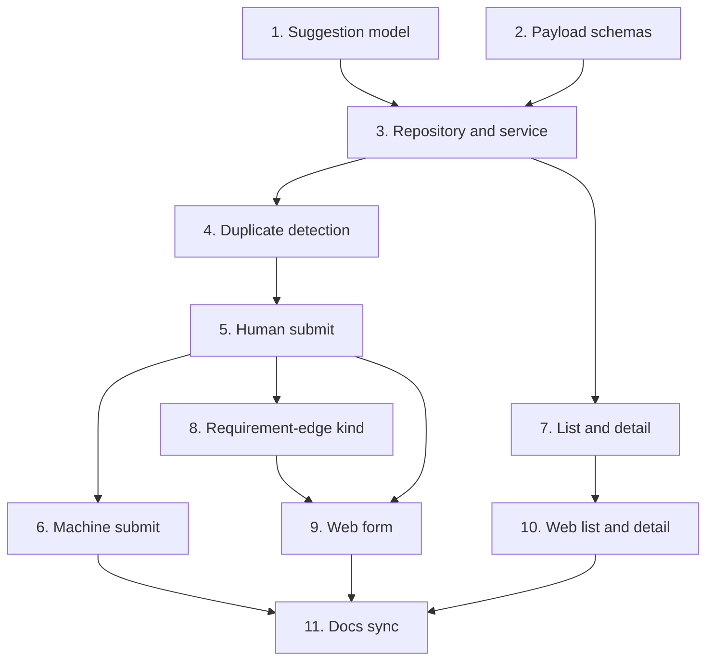

# Suggestion Interface — Rollout

**Architecture:** [00-architecture.md](00-architecture.md) · **Decisions:** [gaps-and-decisions.md](gaps-and-decisions.md) · **Chapters:** [chapters/](chapters/)

**Prerequisites:** [ci-foundation](../ci-foundation/01-rollout.md) 1–2; [auth](../auth/01-rollout.md) chapters 2, 4 and 8 (user model, current user, machine principal).

---

## The three invariants

1. **Additive only.** Existing routes and tables are untouched; `document` and `document_requirement` are
   read, never written. New tables and enums only, each migration reversible.
2. **Independently shippable.** After each chapter `./ci.sh` passes and the documents list and detail behave
   exactly as before. Web chapters add routes that are unlinked until chapter 9 adds the menu entry.
3. **Pending only.** No code path in this suite sets a status other than `pending`.

---

## Dependency graph



Chapters 1 and 2 are independent. Chapter 7 can proceed in parallel with 4–6. The web chapters 9 and 10 are
independent of each other once their backend chapters have shipped.

---

## Chapters

| # | Chapter | Layer | Gate | Plan | Status |
| --- | --- | --- | --- | --- | --- |
| 1 | Suggestion model and migration | model + migration | pytest + round-trip + `./ci.sh` | [01-suggestion-model-migration.md](chapters/01-suggestion-model-migration.md) | shipped |
| 2 | New-document payload schema | backend | pytest + `./ci.sh` | [02-new-document-payload-schema.md](chapters/02-new-document-payload-schema.md) | shipped |
| 3 | Repository and service | backend | pytest + `./ci.sh` | [03-suggestion-repository-service.md](chapters/03-suggestion-repository-service.md) | shipped |
| 4 | Duplicate detection | backend | pytest + `./ci.sh` | [04-duplicate-detection.md](chapters/04-duplicate-detection.md) | shipped |
| 5 | Human submit endpoint | backend | pytest + `./ci.sh` | [05-human-submit-endpoint.md](chapters/05-human-submit-endpoint.md) | shipped |
| 6 | Machine submit endpoint | backend | pytest + `./ci.sh` | [06-machine-submit-endpoint.md](chapters/06-machine-submit-endpoint.md) | shipped |
| 7 | List and detail endpoints | backend | pytest + `./ci.sh` | [07-list-and-detail-endpoints.md](chapters/07-list-and-detail-endpoints.md) | shipped |
| 8 | Requirement-edge kind | backend | pytest + `./ci.sh` | [08-requirement-edge-kind.md](chapters/08-requirement-edge-kind.md) | shipped |
| 9 | Web suggestion form | frontend + i18n | vitest + `./ci.sh` + manual | [09-web-suggestion-form.md](chapters/09-web-suggestion-form.md) | shipped |
| 10 | Web list and detail | frontend + i18n | vitest + `./ci.sh` + manual | [10-web-suggestion-list-and-detail.md](chapters/10-web-suggestion-list-and-detail.md) | shipped |
| 11 | Docs sync | docs | link check | [11-docs-sync.md](chapters/11-docs-sync.md) | shipped |
| 12 | Jurisdiction applicability (web) | frontend + API | vitest + pytest + `./ci.sh` | [12-jurisdiction-applicability-web.md](chapters/12-jurisdiction-applicability-web.md) | shipped |
| 13 | Catalogue detail and evidence | frontend + i18n | vitest + `./ci.sh` | [13-catalogue-detail-and-evidence.md](chapters/13-catalogue-detail-and-evidence.md) | shipped |
| 14 | Discovery emit contract tests | backend | pytest + `./ci.sh` | [14-discovery-emit-contract-tests.md](chapters/14-discovery-emit-contract-tests.md) | shipped |
| 15 | Discovery bridge docs | docs | link check | [15-discovery-bridge-docs.md](chapters/15-discovery-bridge-docs.md) | shipped |

Typical negative assertions per slice: unauthenticated, wrong principal kind, invalid payload, unknown
jurisdiction, unknown taxonomy code, non-http URL, duplicate document, duplicate pending suggestion,
idempotent replay, both/neither of `jurisdiction_id` and `municipality_code`.

## Per-chapter gate

```bash
# backend chapters
cd apps/api && python -m pytest tests/<file>.py
cd ../.. && ./ci.sh

# migration chapters, additionally
cd apps/api && alembic upgrade head && alembic downgrade -1 && alembic upgrade head

# web chapters
cd apps/web
npm run test -- <paths>
npm run lint && npm run format:check && npm run typecheck && npm run build
cd ../.. && ./ci.sh
```

**Refactor gate** (reported per chapter): methods ~5 LOC, classes ~100 LOC, at most one level of nesting,
commit at least once per green. Branches `feat/suggestions-<name>`, conventional commits (`test(api): …`
then `feat(api): …`, or `web` scope), one PR per chapter, never commit to `main`.
