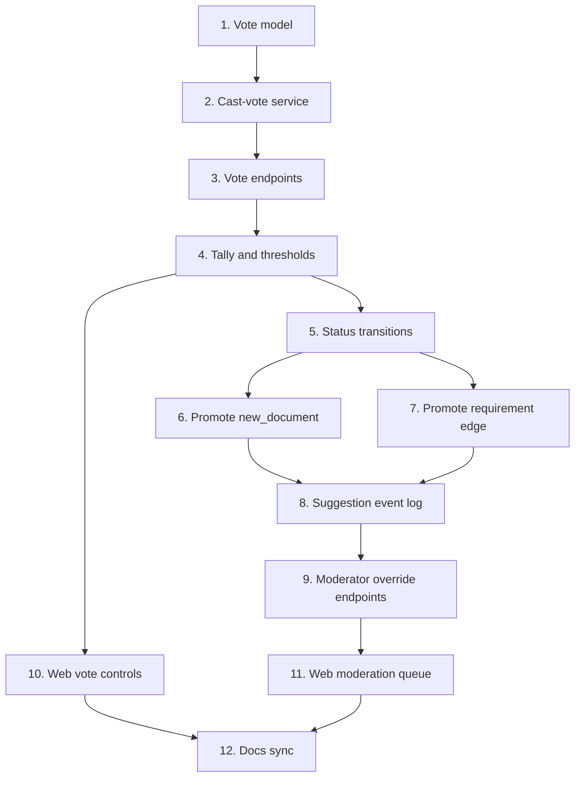

# Voting Moderation — Rollout

**Architecture:** [00-architecture.md](00-architecture.md) · **Decisions:** [gaps-and-decisions.md](gaps-and-decisions.md) · **Chapters:** [chapters/](chapters/)

**Prerequisites:** [auth](../auth/01-rollout.md) (users, role guards); [suggestion-interface](../suggestion-interface/01-rollout.md) (suggestion model and both kinds).

---

## The three invariants

1. **Additive only.** New tables only; `document`/`document_requirement` gain rows only through the
   promotion path, never a schema change.
2. **Independently shippable.** After each chapter `./ci.sh` passes and suggestions stay readable and
   submittable exactly as before. Chapters 1–3 ship with tallies simply unused by any UI.
3. **The event log is append-only, everywhere.** No chapter adds an update or delete path for
   `suggestion_event`.

---

## Dependency graph



Chapters 6 and 7 (promotion per kind) are independent of each other once chapter 5 ships. Chapter 10 can
start once chapter 4 ships, in parallel with 5–9.

---

## Chapters

| # | Chapter | Layer | Gate | Plan | Status |
| --- | --- | --- | --- | --- | --- |
| 1 | Vote model and migration | model + migration | pytest + round-trip + `./ci.sh` | [01-vote-model-migration.md](chapters/01-vote-model-migration.md) | planned |
| 2 | Cast-vote service | backend | pytest + `./ci.sh` | [02-cast-vote-service.md](chapters/02-cast-vote-service.md) | planned |
| 3 | Vote endpoints | backend | pytest + `./ci.sh` | [03-vote-endpoints.md](chapters/03-vote-endpoints.md) | planned |
| 4 | Tally and thresholds | backend | pytest + `./ci.sh` | [04-tally-and-thresholds.md](chapters/04-tally-and-thresholds.md) | planned |
| 5 | Status transitions | backend | pytest + `./ci.sh` | [05-status-transitions.md](chapters/05-status-transitions.md) | planned |
| 6 | Promote new_document | backend | pytest + `./ci.sh` | [06-promote-new-document.md](chapters/06-promote-new-document.md) | planned |
| 7 | Promote requirement edge | backend | pytest + `./ci.sh` | [07-promote-requirement-edge.md](chapters/07-promote-requirement-edge.md) | planned |
| 8 | Suggestion event log | model + migration + backend | pytest + round-trip + `./ci.sh` | [08-suggestion-event-log.md](chapters/08-suggestion-event-log.md) | planned |
| 9 | Moderator override endpoints | backend | pytest + `./ci.sh` | [09-moderator-override-endpoints.md](chapters/09-moderator-override-endpoints.md) | planned |
| 10 | Web vote controls | frontend + i18n | vitest + `./ci.sh` + manual | [10-web-vote-controls.md](chapters/10-web-vote-controls.md) | planned |
| 11 | Web moderation queue | frontend + i18n | vitest + `./ci.sh` + manual | [11-web-moderation-queue.md](chapters/11-web-moderation-queue.md) | planned |
| 12 | Docs sync | docs | link check | [12-docs-sync.md](chapters/12-docs-sync.md) | planned |

Typical negative assertions per slice: voting on your own suggestion, voting twice, voting on a non-pending
suggestion, invalid vote value, unauthenticated vote, non-moderator override, overriding a non-pending
suggestion, promoting an already-promoted suggestion.

## Per-chapter gate

```bash
# backend chapters
cd apps/api && python -m pytest tests/<file>.py
cd ../.. && ./ci.sh

# migration chapters, additionally
cd apps/api && alembic upgrade head && alembic downgrade -1 && alembic upgrade head

# web chapters
cd apps/web
npm run test -- <paths>
npm run lint && npm run format:check && npm run typecheck && npm run build
cd ../.. && ./ci.sh
```

**Refactor gate** (reported per chapter): methods ~5 LOC, classes ~100 LOC, at most one level of nesting,
commit at least once per green. Branches `feat/voting-<name>`, conventional commits (`test(api): …` then
`feat(api): …`, or `web` scope), one PR per chapter, never commit to `main`.
