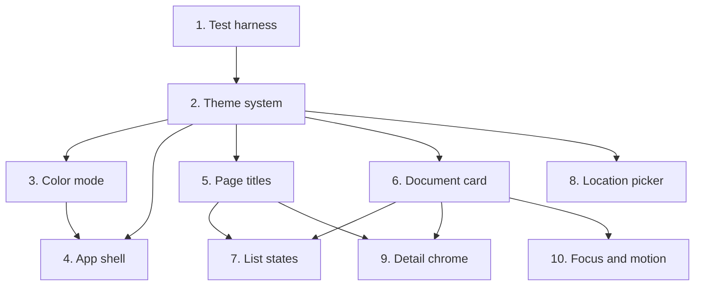

# Web Frontend Visual Alignment — Rollout

**Architecture:** [00-architecture.md](00-architecture.md) · **Decisions:** [gaps-and-decisions.md](gaps-and-decisions.md) · **Chapters:** [chapters/](chapters/)

---

## The two invariants

1. **No new product behavior.** Routes, query hooks, locale/API wiring, and location filter logic stay
   as they are. Styling, theme, test harness, and an explicit not-found view are allowed.
2. **Independently shippable.** After each chapter, `cd apps/web && npm test` (from chapter 1 onward)
   and `./ci.sh` pass; `/documents` and `/documents/:id` still render.

---

## Dependency graph



Chapters 5 and 6 both depend on 2 only; 7 depends on 5 and 6; 9 depends on 5 and 6; 10 depends on 6.

---

## Chapters

| # | Chapter | Gate | Plan | Status |
| --- | --- | --- | --- | --- |
| 1 | Test harness + not-found | vitest + `./ci.sh` | [01-test-harness.md](chapters/01-test-harness.md) | done |
| 2 | Theme system (red + Iceberg/Inter) | vitest + `./ci.sh` | [02-theme-system.md](chapters/02-theme-system.md) | planned |
| 3 | Color mode | vitest + `./ci.sh` | [03-color-mode.md](chapters/03-color-mode.md) | planned |
| 4 | App shell | vitest + `./ci.sh` + manual | [04-app-shell.md](chapters/04-app-shell.md) | planned |
| 5 | Page titles | vitest + `./ci.sh` | [05-page-titles.md](chapters/05-page-titles.md) | planned |
| 6 | Document card | vitest + `./ci.sh` | [06-document-card.md](chapters/06-document-card.md) | planned |
| 7 | List states | vitest + `./ci.sh` | [07-list-states.md](chapters/07-list-states.md) | planned |
| 8 | Location picker | vitest + `./ci.sh` | [08-location-picker.md](chapters/08-location-picker.md) | planned |
| 9 | Detail chrome | vitest + `./ci.sh` | [09-detail-chrome.md](chapters/09-detail-chrome.md) | planned |
| 10 | Focus and motion | vitest + `./ci.sh` | [10-focus-and-motion.md](chapters/10-focus-and-motion.md) | planned |

---

## Per-chapter gate

```bash
cd apps/web
npm run test -- <paths named in the chapter>
npm run lint && npm run format:check && npm run typecheck && npm run build
cd ../.. && ./ci.sh
```

Chapter 1 additionally edits [ci.sh](../../ci.sh) to run `npm test` in the web section.

Manual checklist items (chapter 4+): open dev server, confirm canvas `#E3E2DF`, wine primary on links,
Iceberg wordmark, dark toggle flips semantic tokens.

---

## Red / green / refactor

Every chapter plan lists **paired** tests (happy + negative) in its Red tests table, confirms both
fail before green, and ends with a **Refactor gate** outcome on the containing entity per
[refactor-step.mdc](../../.cursor/rules/refactor-step.mdc).

Typical frontend negative paths:

| Slice | Negative assertion |
| --- | --- |
| Theme | Unknown semantic token; heading style must not request bold |
| List | Error → Alert, no cards; loading → Skeleton; empty → EmptyState |
| Picker | Child select disabled without parent value |
| Detail | Empty requirements → EmptyState; empty jurisdiction → no breadcrumb |
| Card | Missing description → no `Card.Description` node |

---

## Git workflow (implementation)

Each chapter: `git checkout main && git pull`, then `git checkout -b feat/web-visual-<slug>`.
Conventional commits scoped to `apps/web` and `ci.sh`. One MR per chapter recommended.

This documentation pass uses branch `docs/web-frontend-visual-plans` and touches only `.plans/` and
one link in the strand README.
