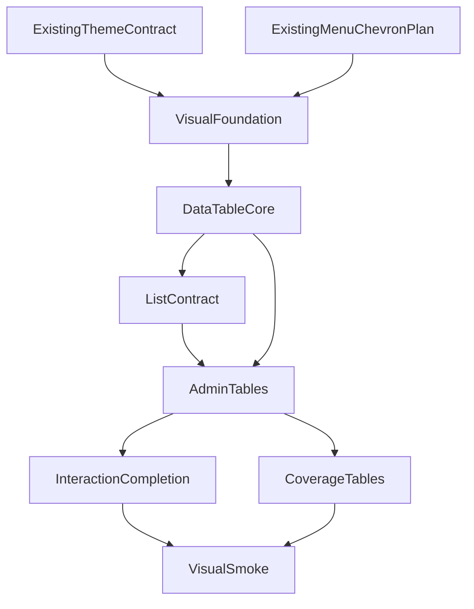

# Web GUI harmonization — Architecture

**Repo:** `redtape` (`apps/web` plus the list-query API contract)  
**Rollout:** [01-rollout.md](01-rollout.md) · **Decisions:** [gaps-and-decisions.md](gaps-and-decisions.md) · **Chapters:** [chapters/](chapters/)

**Status:** planned.

This suite turns the visual observations from the reference UI into a RedTape-specific contract. The
reference supplies reusable interaction patterns and component boundaries; RedTape keeps its red
palette, product language, information architecture, and Chakra namespace-import rules already
established by [web-frontend](../web-frontend/00-architecture.md).

## 1. Problem statement

RedTape has a custom Chakra system and document-card elevation, but admin surfaces still use separate
table, query-status, filter, and pagination implementations. Coverage is primarily rendered as badges
and labels. The result is functionally useful but visually flat and inconsistent:

- sections and toolbars do not share a surface, border, shadow, or spacing contract;
- admin tables use direct `Table.Root` markup with inconsistent state and typography treatment;
- discovery documents have server paging, tasks do not expose their response total or paging controls,
  and catalogue uses a fixed page size;
- sorting, filtering, search, and pagination are not represented by one stable frontend/backend
  interface;
- coverage repeats summary information between catalogue and coverage routes and hides relationships
  that are clearer in rows and columns;
- the document-list count must remain plain text with no non-functional expansion affordance.

The target is a restrained, raised, readable interface. It is not a redesign of product IA and it
does not turn every content-oriented document preview into a dense table.

## 2. Surface inventory

| Surface | Current implementation | Target |
| --- | --- | --- |
| Application shell and page sections | `AppLayout`, route containers, ad hoc `Stack`/`Box` | Shared surface and section composition using semantic elevation tokens |
| Discovery catalogue | `CatalogueServicesTable`, coverage summary | Shared `DataTable` plus reusable coverage summary |
| Discovery documents | `DiscoveryDocumentsTable`, bespoke query-status wrapper | Shared `DataTable`, typed columns, URL-backed query state, server paging |
| Discovery tasks | `DiscoveryTasksTable`, current-page count, no visible paging | Shared `DataTable`, total-aware state, server sort/filter/paging |
| Document mentions | `DocumentMentionsTable` | Shared `DataTable` with long-content cell treatment |
| Coverage | `CoverageChips`, `LlmCoverage`, `BudgetMeters`, `FailuresBySource`, `LastRunSummary` | Grouped metric tables with badges only for status/severity |
| Pipeline/detail data lists | Artifact groups, edge lists, tag/support rows, and emit-preview metadata | Shared `DataTable` for comparable records; keep timelines and structured payload previews in their appropriate semantic components |
| Public documents and suggestions | Card/list query-status patterns | Audit; keep cards for document previews, use the table for operational data |
| Document count row | `QueryStatusView` plain muted text | Plain muted text; no `aria-expanded` or expansion chevron |

Primary source files include:

- `apps/web/src/theme/index.ts`, `theme/semantic-tokens/table.ts`,
  `theme/semantic-tokens/surfaces.ts`, `theme/semantic-tokens/shadows.ts`, and
  `theme/textStyles.ts`;
- `apps/web/src/components/data-display/AppCard.tsx` and
  `components/feedback/QueryStatusView.tsx`;
- `apps/web/src/features/discovery-admin/components/DiscoveryDocumentsTable.tsx`,
  `DiscoveryTasksTable.tsx`, `CatalogueServicesTable.tsx`, and
  `DocumentMentionsTable.tsx`;
- `apps/web/src/features/discovery-admin/components/CoverageChips.tsx`,
  `LlmCoverage.tsx`, `BudgetMeters.tsx`, `FailuresBySource.tsx`, and
  `LastRunSummary.tsx`;
- `apps/web/src/features/discovery-admin/hooks/*Query.ts`,
  `components/*Filters.tsx`, and `services/discoveryAdminApi.ts`.

## 3. Visual principles

### 3.1 Elevation is semantic and restrained

Use one elevation vocabulary:

| Surface | Treatment |
| --- | --- |
| Canvas | `bg.canvas`, no shadow |
| Section/card/table shell | `surface.base`, subtle border, `shadow.card` or the table-shell equivalent |
| Interactive linked card | card elevation plus the existing small hover lift |
| Popover/filter menu | `surface.elevated`, `shadow.dropdown`, visible focus |
| Modal/critical overlay | the existing modal token only |

Static admin sections should be visibly separated from the canvas without looking like floating
panels. Do not add independent one-off shadows, raw hex colours, or nested cards solely to create
contrast.

### 3.2 Typography carries hierarchy

Use the existing text styles (`pageTitle`, `sectionHeader`, `subsectionHeader`, `body`, `caption`,
`mono`, and `code`) instead of local font-size/weight combinations. Table headers use the table header
style; cells use body/mono styles according to the value. Muted text is for supporting context, not
the only way to distinguish a primary value.

### 3.3 Tables are the default for operational data

An operational view is a table when users compare records, scan counts, inspect statuses, or take a
row-level action. A badge may communicate state inside a cell but must not replace the row/column
relationship. Cards remain valid for a document preview whose title, description, and action are
better read as a single content unit.

### 3.4 Interaction states are part of the component

Every list shell has explicit loading, error, empty, populated, and refreshing states. Refreshing
keeps the previous rows visible with `aria-busy` and subdued opacity. Search, filters, and sort reset
the page to the first page. Invalid server input is rejected explicitly and does not create a partial
or stale mutation.

### 3.5 Accessibility and responsive behavior are non-negotiable

Use real table semantics, keyboard-operable sort/filter controls, visible focus, accessible names,
and row links that do not swallow nested controls. Tables use horizontal overflow at narrow widths;
they do not silently hide data. Long URLs, excerpts, and identifiers use a deliberate truncation or
wrap policy with a tooltip only when the full value is needed.

## 4. Target component architecture

```text
apps/web/src/components/
├── data-display/
│   ├── DataTable/
│   │   ├── DataTable.tsx
│   │   ├── DataTableHeader.tsx
│   │   ├── DataTableRow.tsx
│   │   ├── DataTableStateView.tsx
│   │   ├── pagination.ts
│   │   ├── sorting.ts
│   │   ├── types.ts
│   │   └── index.ts
│   ├── SectionCard.tsx
│   └── TerseTableCell.tsx
├── feedback/
│   └── shared list state components
└── layout/
    └── ListHeader.tsx / toolbar composition

apps/web/src/features/discovery-admin/
├── components/
│   ├── columns/
│   │   ├── catalogueColumns.tsx
│   │   ├── candidateColumns.tsx
│   │   ├── taskColumns.tsx
│   │   └── mentionColumns.tsx
│   ├── DiscoveryDataTable.tsx
│   └── coverage/
├── hooks/
│   └── useDiscoveryListState.ts
└── services/
    └── typed list-query adapters
```

`DataTable` owns presentation, table interaction mechanics, and state slots. Feature column builders
own labels, cell formatting, links, and domain-specific filter schemas. Feature hooks own query
state and cache keys. Services map typed query state to API parameters. No component imports a feature
service directly.

## 5. Stable list interface

The interface has three layers.

### 5.1 Frontend table types

The exact names can be adjusted during implementation, but the responsibilities are fixed:

```ts
type SortOrder = "asc" | "desc";

type DataTableQueryState<SortKey extends string, FilterKey extends string> = {
  offset: number;
  limit: number;
  sortBy?: SortKey;
  sortOrder?: SortOrder;
  search?: string;
  filters: Partial<Record<FilterKey, string | number | boolean | string[]>>;
};

type DataTablePage<Row> = {
  items: Row[];
  total: number;
  offset: number;
  limit: number;
};

type DataTableColumn<Row, SortKey extends string, FilterKey extends string> = {
  key: string;
  header: ReactNode;
  canSort?: SortKey;
  filter?: { key: FilterKey; operators: readonly FilterOperator[] };
  render: (row: Row) => ReactNode;
};
```

Columns declare capability rather than implying it. A display-only column cannot accidentally send an
unsupported server field. The table toggles sort order, renders filter controls, exposes state
changes to the parent, and never constructs resource-specific URLs.

### 5.2 HTTP query contract

Existing `offset` and `limit` remain supported. New list endpoints use:

```text
GET /resource?
  offset=0&
  limit=20&
  sort_by=created_at&
  sort_order=desc&
  q=keyword&
  filter[source]=pvog&
  filter[status]=pending
```

Resource query models define the allowed sort fields, filter keys, value types, and operators. The
server rejects unknown fields, invalid enum values, malformed filter values, and out-of-range limits
with the existing validation error shape. It applies a deterministic secondary key after the requested
sort so page boundaries do not oscillate between requests.

Resource-specific legacy parameters can remain as compatibility aliases during rollout, but the
typed service adapter must emit one canonical representation. A later removal of an alias is a
separate compatibility decision, not a silent frontend change.

### 5.3 Response and state semantics

Every paginated list returns `{items, total, offset, limit}`. `total` is the count for the complete
filtered result, not the current page. An empty filtered result is a successful response with
`items: []`; it is not an error. A failed refetch preserves the previous page in the UI and exposes
retry/error feedback. A new filter, search term, or sort order sets `offset=0` before fetching.

## 6. Backend touch points

The current shared pagination model in `apps/api/app/shared/paging.py` is the starting point. The
discovery list controllers and candidate filter model define the first allowlists. The implementation
must cover:

- discovery candidates, catalogue, tasks, and mentions where the API can support server paging;
- public document and suggestion lists only where the endpoint already exposes compatible metadata or
  the API chapter explicitly adds it;
- stable validation and deterministic ordering tests at the API boundary;
- OpenAPI/API documentation updates if the project exposes those contracts.

The backend does not accept arbitrary SQL/order fragments from the client. Each resource maps the
public sort key to a known column expression and applies a stable secondary sort.

## 7. Scope boundaries

In scope:

- shared visual surface and table tokens;
- a reusable Chakra DataTable and Chakra pagination control;
- typed frontend query state and backend list-query contract;
- all discovery admin list/table surfaces and coverage metric presentation;
- nested pipeline/detail lists whenever the data is row-comparable; narrative timelines and structured
  payload previews remain non-table surfaces;
- the document-count chevron regression and visual smoke integration;
- accessibility, responsive behavior, tests, and plan/index documentation.

Out of scope:

- a new product information architecture;
- replacing the existing RedTape brand palette or fonts;
- copying domain-specific reference application chrome;
- database schema changes unrelated to list querying;
- converting content-oriented document cards without a demonstrated scanning benefit;
- auth, routing, or crawler behavior changes.

## 8. Dependency graph



