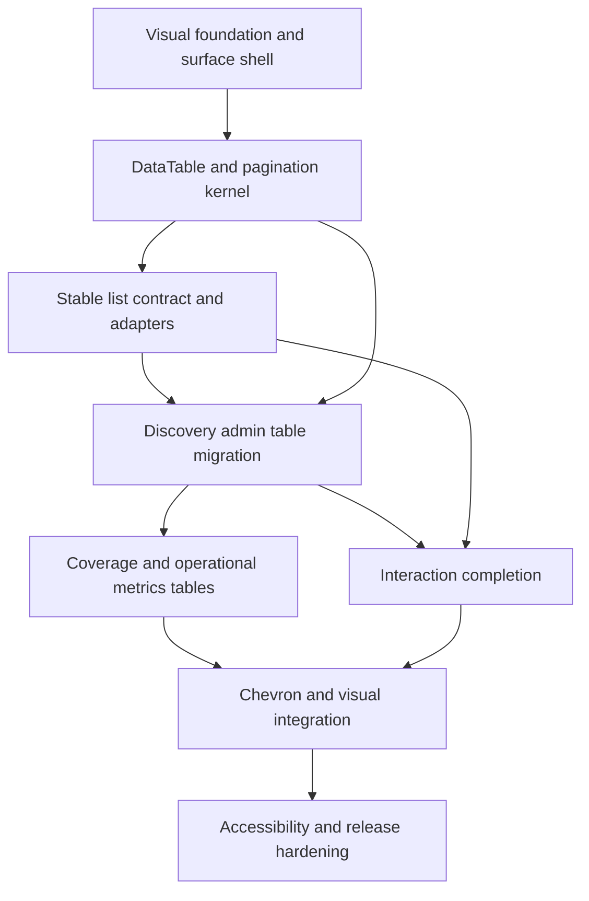

# Web GUI harmonization — Rollout

**Architecture:** [00-architecture.md](00-architecture.md) · **Decisions:** [gaps-and-decisions.md](gaps-and-decisions.md) · **Chapters:** [chapters/](chapters/) · **Ledger:** [run-ledger.md](run-ledger.md)

**Loop branch:** `feat/plans-web-gui-harmonization`  
**Release branch:** `main`

## The five invariants

1. **RedTape brand stays authoritative.** Reference interaction patterns may be adopted, but the
   existing RedTape palette, typography, information architecture, and Chakra conventions remain.
2. **One table language.** Operational admin data uses the shared DataTable, shared table tokens,
   shared state handling, and Chakra pagination. Feature columns provide domain rendering only.
3. **No silent data loss.** Narrow screens use horizontal overflow; loading, empty, error, and
   refreshing states remain explicit; invalid query controls do not produce partial writes.
4. **Server-side semantics are typed.** Sort and filter fields are allowlisted per resource, response
   totals describe the full filtered result, and URL state is serializable and deterministic.
5. **Every chapter is independently green.** Each chapter names a happy and negative test before
   implementation, runs the refactor audit over its containing entity, and passes the local CI gate.

## Prerequisites and ownership

- Reuse the theme and typography decisions from [web-frontend](../web-frontend/00-architecture.md);
  do not reopen its red palette or font decisions.
- Coordinate with [frontend-ui-menu](../frontend-ui-menu/01-rollout.md). Its chapter
  `01-remove-list-chevron.md` owns the document-count chevron regression. This suite may assert the
  integration outcome but must not duplicate that chapter's implementation.
- The API contract chapter may touch shared pagination and discovery list endpoints. It must not
  change discovery authorization, ingestion, or unrelated database behavior.
- All chapter merges go into the loop branch. The release PR is the only merge into `main`.

## Dependency graph



## Execution order

1. [01-visual-foundation.md](chapters/01-visual-foundation.md)
2. [02-data-table-kernel.md](chapters/02-data-table-kernel.md)
3. [03-list-contract-and-adapters.md](chapters/03-list-contract-and-adapters.md)
4. [04-discovery-admin-tables.md](chapters/04-discovery-admin-tables.md)
5. [05-coverage-metrics-tables.md](chapters/05-coverage-metrics-tables.md)
6. [06-table-interactions.md](chapters/06-table-interactions.md)
7. [07-chevron-and-visual-integration.md](chapters/07-chevron-and-visual-integration.md)
8. [08-accessibility-release-hardening.md](chapters/08-accessibility-release-hardening.md)

## Chapters

| # | Chapter | Layer | Gate | Status |
| --- | --- | --- | --- | --- |
| 1 | [Visual foundation and surface shell](chapters/01-visual-foundation.md) | web | Vitest + `./ci.sh` | planned |
| 2 | [DataTable and Chakra pagination kernel](chapters/02-data-table-kernel.md) | web | Vitest + `./ci.sh` | planned |
| 3 | [Stable list contract and adapters](chapters/03-list-contract-and-adapters.md) | API + web | pytest/Vitest + `./ci.sh` | planned |
| 4 | [Discovery admin table migration](chapters/04-discovery-admin-tables.md) | web | Vitest + `./ci.sh` | planned |
| 5 | [Coverage and operational metrics tables](chapters/05-coverage-metrics-tables.md) | web | Vitest + `./ci.sh` | planned |
| 6 | [Filter, search, sort, and pagination completion](chapters/06-table-interactions.md) | API + web | pytest/Vitest + `./ci.sh` | planned |
| 7 | [Chevron and visual integration](chapters/07-chevron-and-visual-integration.md) | web | Vitest + manual smoke + `./ci.sh` | planned |
| 8 | [Accessibility and release hardening](chapters/08-accessibility-release-hardening.md) | web + docs | Vitest + manual smoke + `./ci.sh` | planned |

## Per-chapter gate

```bash
cd apps/web
npm run test -- <paths named in the chapter>
npm run lint
npm run format:check
npm run typecheck
npm run build
cd ../..
./ci.sh
```

API chapters also run the narrow pytest path named in the chapter before the full gate. A chapter
cannot be marked green when only the happy path passes.

## Manual smoke after chapter 8

- Light and dark mode show a consistent canvas, raised table/section shells, borders, shadows, and
  text hierarchy without excessive decoration.
- `/admin/discovery/catalogue`, `/coverage`, `/tasks`, `/documents`, document detail, and pipeline
  detail use the same table shell and state language where data is tabular.
- Every visible admin table can sort/filter/search where its column contract declares support.
- Changing search, filter, or sort resets to page one; pagination controls use Chakra semantics and
  disappear for a single page.
- Long cells remain inspectable at narrow widths; no data is silently hidden.
- Loading, empty, error, and refreshing states are visible and retryable.
- `/documents` has no non-functional expand chevron beside the count.
- Keyboard focus and accessible names are visible for table controls, links, filters, and pagination.

## Branch and release protocol

For each chapter:

```bash
git checkout feat/plans-web-gui-harmonization && git pull
git checkout -b feat/web-gui-harmonization-<slug>
```

Use a test commit followed by an implementation/refactor commit where practical. Use conventional
commits such as `test(web): define DataTable pagination states` and
`feat(web): add shared admin DataTable`. Open each chapter PR into the loop branch. After all eight
chapters are green and the ledger is complete, open one release PR from
`feat/plans-web-gui-harmonization` to `main`.

